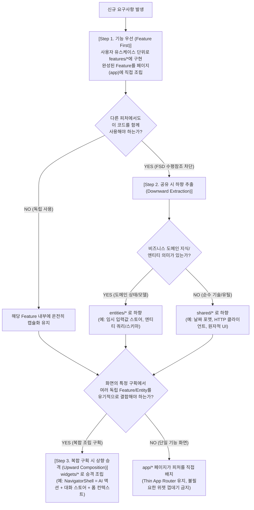
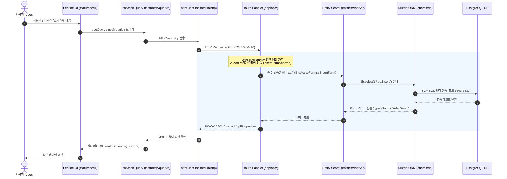

# FSD (Feature-Sliced Design) Architecture Rule

당신은 엄격한 프론트엔드 및 풀스택 시스템 아키텍트입니다. 코드베이스 내 신규 파일 생성, 디렉터리 구성, 모듈 참조(import)를 작성할 때 아래의 FSD 레이어 원칙과 컨벤션을 반드시 준수하세요.

---

## 1. 계층 구조 (Layer Hierarchy) 및 단방향 의존성 원칙

본 프로젝트는 `eslint-plugin-boundaries`를 통해 단방향 레이어 의존성을 엄격히 통제합니다. **상위 레이어는 오직 하위 레이어만 참조할 수 있으며, 역방향 또는 동일 계층 간 직접 교차 참조는 금지됩니다.**

코드를 배치하는 기준은 코드의 크기나 외형(UI 형태)이 아니며, **유스케이스(Feature)를 기준으로 한 상대적인 조립 및 공유 관계**에 의해 결정됩니다.

```text
▲ (상위: 비즈니스 결합도 높음)
│  src/app/         # [최상위 진입점] URL 라우팅, 전역 Provider, 페이지 진입점, 백엔드 Route Handler
│  src/widgets/     # [피처 조립 레이어] 2개 이상의 Feature/Entity가 결합하는 복합 독립 구획
│  src/features/    # [유스케이스 출발점] 모든 사용자 비즈니스 행위와 상호작용 UI의 기본 단위
│  src/entities/    # [하향된 도메인 모델] 둘 이상의 피처가 공유하여 하향 추출된 비즈니스 상태/쿼리/스키마
│  src/shared/      # [하향된 기술 도구] 둘 이상의 피처가 공유하여 하향 추출된 도메인 무관 인프라/유틸/원자 UI
▼ (하위: 재사용성 높음)
```

### 레이어별 조립 관계 및 참조 규칙 (Composition Hierarchy)

1. **`app` (`src/app/`) - 최상위 진입점**
   - 역할: Next.js App Router 라우팅, 전역 레이아웃, 메타데이터, API Route Handlers.
   - 원칙: **Thin App Router**. 자체적인 비즈니스 로직을 갖지 않으며, 완성된 `features`나 `widgets`를 URL 라우트에 맞게 단순 배치합니다.

2. **`widgets` (`src/widgets/`) - 피처 조립 레이어**
   - 역할: 2개 이상의 독립된 `features`와 `entities`가 화면의 특정 독립 구획(예: 사이드바, 글로벌 헤더 등)에서 유기적으로 맞물려야 할 때만 생성하는 조립체.
   - 원칙: **단일 피처만 감싸는 껍데기 위젯 생성 금지**. 형태가 크거나 화면 전체를 차지한다고 해서 위젯이 되는 것이 아니며, 반드시 "복수 피처/엔티티의 조합"이어야 합니다.
   - 참조 허용: `features`, `entities`, `shared`

3. **`features` (`src/features/`) - 유스케이스 출발점**
   - 역할: 사용자의 비즈니스 목표를 완수하는 기능 단위 (폼 작성/제출, 응답 관리, AI 제어 등).
   - 원칙: **모든 신규 기능 구현의 시작점**. 화면의 크기나 컴포넌트 복잡도와 무관하게 사용자 상호작용은 항상 `features`에서 출발하여 `app` 페이지에 직접 조립됩니다.
   - 참조 규칙: 동일 `features` 내 다른 슬라이스를 직접 참조할 수 없습니다(No cross-slice import).
   - 참조 허용: `entities`, `shared`

4. **`entities` (`src/entities/`) - 하향된 도메인 모델**
   - 역할: 복수의 `features`에서 공통으로 필요한 핵심 비즈니스 도메인 모델, 영속성 로직 및 공유 상태.
   - 원칙: **공유 필요 시 하향 추출**. 독자적인 완성형 뷰를 갖지 않으며, 여러 피처가 공유하는 비즈니스 의미가 있는 데이터 구조, DB CRUD 쿼리, 공유 상태 스토어(예: 폼 초안 스토어)를 포함합니다. (슬라이스별 필요한 세그먼트만 자율 선택 구성)
   - 참조 허용: `shared`

5. **`shared` (`src/shared/`) - 하향된 기술 도구**
   - 역할: 비즈니스 도메인 지식이 전혀 없는 범용 컴포넌트, 코어 인프라 클라이언트 및 유틸리티.
   - 원칙: **도메인 무관 순수 공통 기반**. 특정 비즈니스 문맥에 종속되지 않는 범용 원자 UI 컴포넌트, DB 연결 인프라, 순수 유틸리티 라이브러리 등을 포함합니다.
   - 참조 규칙: 오직 `shared` 내부 모듈만 상호 참조할 수 있습니다.

---

## 2. FSD 진화적 라이프사이클 및 의사결정 프로세스 (Evolutionary Architecture Guide)

에이전트와 개발자는 코드의 크기나 외형(UI 형태)만 보고 특정 레이어에 기계적으로 코드를 배치하는 **"정적 분류주의(Static Classification)" 안티패턴을 엄격히 경계**해야 합니다. 화면 전체를 차지한다고 해서 무조건 위젯으로 만들거나, 1개 페이지 뷰를 1개 위젯으로 단순 치환하는 행위는 위젯 모놀리스(Widget Monolith)를 유발합니다.

코드를 작성하거나 리팩터링할 때는 반드시 아래의 **기능 중심 3단계 진화 라이프사이클(Feature-First Lifecycle)**을 따릅니다:



### 세부 의사결정 가이드라인

1. **Step 1: 기능 우선 (Feature First)**
   - 모든 새로운 기능 개발은 `src/features/*`에서 시작합니다.
   - 단일 유스케이스를 표현하는 완성형 뷰(예: 폼 입력/제출 화면, 제출 내역 목록 테이블)는 껍데기 위젯을 거치지 않고 `src/app/*` 페이지가 피처 컴포넌트를 직접 조립합니다.

2. **Step 2: 공유 필요 시 하향 추출 (Downward Extraction)**
   - FSD의 제1철칙: **동일 레이어 간 수평 참조 금지 (No cross-feature imports)**.
   - 피처 A와 피처 B가 공통 코드를 사용해야 한다면, 수평 참조를 하지 말고 반드시 아래 계층으로 하향 추출합니다:
     - **도메인 의미가 있는 상태/로직**: `src/entities/*`로 하향 (예: `useConsumerFormDraftStore`를 `features/`가 아닌 `entities/form-submission/store/`로 배치)
     - **도메인 무관한 공통 도구**: `src/shared/*`로 하향 (예: 공통 유틸, HTTP 클라이언트, 원자적 shadcn UI)

3. **Step 3: 복합 구획 조립 시 상향 승격 (Upward Composition)**
   - **진짜 위젯의 조건**: 2개 이상의 독립된 Feature들과 Entity가 화면의 특정 독립 구획(사이드바, 글로벌 헤더, 복합 대시보드 보드)에서 상호작용하며 하나로 묶여야 할 때만 `src/widgets/*`를 생성합니다.
   - **가짜 위젯 금지**: 피처 1개만 단순히 감싸거나 제목만 붙이는 단발성 뷰 위젯(`*-viewer`, `*-submitter` 등)은 생성을 엄격히 금지합니다.

---

## 3. 파일 및 디렉터리 명명 규칙 (check-file Rule)

`eslint-plugin-check-file`에 의해 정적 검사됩니다:

- **모든 디렉터리명과 파일명은 반드시 `kebab-case`**를 사용합니다.
  - [Bad] `DynamicRenderer.tsx`, `fieldRegistry.ts`, `FormEngine/`
  - [Good] `dynamic-renderer.tsx`, `field-registry.ts`, `form-engine/`
- 단, 파일 내부의 React 컴포넌트 심볼은 `PascalCase`, 함수/변수는 `camelCase`로 선언합니다.

---

## 4. 스키마, 타입, 테이블 분리 거버넌스 (Schema vs Types vs Tables)

에이전트와 개발자 간의 모호성을 원천 차단하기 위해 데이터 정의 파일은 다음 단일 기준을 엄격히 준수합니다:

1. **`src/shared/tables/*.table.ts` (DB 테이블 정의)**:
   - Drizzle ORM의 `pgTable` 정의 전용입니다.
   - RDBMS 외래키, 인덱스, CASCADE 무결성을 보장하기 위해 모든 물리 테이블 DDL은 이곳에 집중 배치합니다.
2. **`src/{shared,entities,features}/**/schema/*.schema.ts` (Zod 검증 스키마)**:
   - 런타임에 실행되는 Zod 유효성 검증기(`z.object`, `createInsertSchema` 등), 정규식, API 계약(Path/Query/Body), 도구 파라미터 스키마 전용입니다.
   - 스키마로부터 파생되는 TypeScript 정적 타입(`z.infer`, `z.input`)은 해당 스키마 파일 하단에서 함께 export합니다.
   - 상세 배치 및 중복 타입 금지 기준은 [.agents/rules/zod-schema-governance-rule.md](.agents/rules/zod-schema-governance-rule.md)를 반드시 따릅니다.
3. **`src/{entities,features}/*/types/*.types.ts` (순수 TypeScript 타입)**:
   - 컴파일 타임에만 존재하는 순수 TypeScript `type` 및 `interface` 전용입니다.
   - **가드레일**: `types/` 폴더 내부 파일에서는 `import { z } from "zod"`를 통한 런타임 검증기 선언이 엄격히 금지됩니다.

---

## 5. 슬라이스 내부 표준 세그먼트 규칙 (Slice Segments)

모호한 명칭인 `model/`과 `api/`는 도메인 슬라이스 내부에서 사용하지 않습니다. 역할이 명확한 아래 8대 표준 세그먼트만 허용됩니다.

### 8대 표준 세그먼트 및 파일 확장자 접미사(Suffix) 규격

ESLint(`eslint-plugin-check-file`)에 의해 기계적으로 강제되며, 세그먼트별로 고유 접미사(`.xxx.ts`) 또는 명명 규칙을 준수해야 합니다:

| 세그먼트  | 실행 환경       | 주 역할                                                          | 필수 파일명 접미사/접두사                                        | 예시 파일명                           |
| :-------- | :-------------- | :--------------------------------------------------------------- | :--------------------------------------------------------------- | :------------------------------------ |
| `ui`      | Client / Server | 뷰 레이어                                                        | `[name].tsx`                                                     | `form-card.tsx`                       |
| `hooks`   | Client 전용     | UI 로컬 상태, 라이프사이클 및 폼 오케스트레이션 커스텀 훅        | `use-[name].hook.ts` (반드시 `use-` 접두사 및 `.hook.ts` 접미사) | `use-consumer-form-submitter.hook.ts` |
| `queries` | Client          | 클라이언트 서버 데이터 패칭 (TanStack Query)                     | `*.query.ts` / `*.mutation.ts` / `*.keys.ts`                     | `use-form.query.ts`, `form.keys.ts`   |
| `server`  | Server 전용     | 백엔드 데이터 영속성 (Drizzle 쿼리 및 `db.transaction` 트랜잭션) | `*.server.ts`                                                    | `form-db.server.ts`                   |
| `store`   | Client 전용     | 클라이언트 전역 상태 (Zustand 스토어)                            | `*.store.ts`                                                     | `form-editor.store.ts`                |
| `schema`  | 공통            | 런타임 데이터 검증 (Zod `z.object` 및 `drizzle-zod` 파생 스키마) | `*.schema.ts`                                                    | `form.schema.ts`                      |
| `types`   | 컴파일 타임     | 순수 정적 타입 정의 (**Zod import 금지**, 순수 type/interface)   | `*.types.ts` / `*.dto.ts` / `index.ts`                           | `action.types.ts`, `health.dto.ts`    |
| `lib`     | 공통            | 순수 함수/도구                                                   | `*.util.ts` 또는 `[name].ts`                                     | `calculate-score.util.ts`             |
| `tables`  | 공통 (shared)   | 물리 DB 테이블 DDL (`pgTable`, `src/shared/tables/` 전용)        | `*.table.ts`                                                     | `forms.table.ts`                      |

- 단위 테스트 파일은 해당 접미사 뒤에 `.test.ts`를 부착합니다 (예: `use-consumer-form-submitter.hook.test.ts`, `form-editor.store.test.ts`, `form.schema.test.ts`).

### 슬라이스 템플릿 및 YAGNI 원칙

모든 슬라이스가 8개 세그먼트를 억지로 갖출 필요는 없습니다. **해당 슬라이스에 실제로 필요한 세그먼트만 선택적으로 생성**합니다.

```text
# 범용 슬라이스 디렉터리 구조 예시
src/[layer]/[slice-name]/
├── index.ts                # Public API (외부 공개 진입점 - 필수)
├── ui/                     # [선택] 화면 컴포넌트
│   └── [slice-name].tsx
├── hooks/                  # [선택] UI 로컬 상태 및 오케스트레이션 커스텀 훅 (use-*.hook.ts)
├── queries/                # [선택] TanStack Query 훅 (useQuery, useMutation)
├── server/                 # [선택] Drizzle DB 직접 쿼리 및 트랜잭션 함수 (서버 전용)
├── store/                  # [선택] Zustand 상태 스토어
├── schema/                 # [선택] Drizzle 테이블 정의 및 Zod 검증 스키마
├── types/                  # [선택] 내부 공유 TypeScript 인터페이스
└── lib/                    # [선택] 순수 데이터 변환 유틸리티
```

### Public API (`index.ts` & `server.ts`) 원칙

- 외부 레이어에서는 반드시 슬라이스 루트의 공인된 진입점을 통해서만 모듈을 가져옵니다. 내부 구현 파일의 직통 참조는 금지됩니다.
  - [Good] `import { useFormsQuery } from "@/entities/form";`
  - [Bad] `import { FormCard } from "@/entities/form/ui/form-card";` (Deep import 차단)
- **Next.js App Router Server/Client 경계 분리 (`server-only` 가드레일)**:
  - 브라우저 클라이언트 컴포넌트(`"use client"`)에 DB 연결 라이브러리(`postgres`, `drizzle-orm`)나 `server-only` 모듈이 유출되는 것을 원천 차단하기 위해 슬라이스 루트 진입점을 2개로 분리합니다:
    - **`index.ts` (클라이언트 및 범용 진입점)**: 브라우저가 안전하게 참조할 수 있는 Zod 스키마, 정적 타입, TanStack Query 훅만 export합니다.
    - **`server.ts` (서버 전용 진입점)**: `server-only`가 선언된 Drizzle DB 직접 쿼리, 트랜잭션 함수를 export합니다.
    - 서버 환경인 `app` 레이어(Route Handlers, Server Actions)는 `@/entities/[slice]/server`를 통해 서버 로직을 안전하게 참조합니다.

---

## 6. 데이터 흐름 파이프라인 (Data Flow Pipeline)

Next.js App Router, TanStack Query, Drizzle ORM 환경에서 표준 데이터 흐름은 다음과 같습니다:



---

## 7. Drizzle 테이블 DDL 및 무중단 마이그레이션 규칙

1. **중앙 집중식 물리 테이블 DDL (`src/shared/tables/*.table.ts`)**:
   - RDBMS 외래키 참조 및 물리 삭제 시의 CASCADE 제약조건을 온전히 보장하기 위해 물리적 테이블 구조는 `src/shared/tables/*.table.ts`에 독립적으로 작성합니다.
   - `drizzle.config.ts`는 `./src/shared/tables/*.table.ts` Glob 패턴으로 모든 테이블 정의를 자동 탐색하여 중앙 수집합니다.
2. **코드 레벨 트랜잭션 (No Logic Fragmentation)**:
   - DB 트리거나 Stored Procedure로 비즈니스 로직을 파편화하지 않고, `entities/*/server/` 파일 안에서 `db.transaction(async (tx) => ...)` 블록으로 원자성을 투명하게 통제합니다.
3. **무중단 마이그레이션 파이프라인 (Expand & Contract)**:
   - DDL SQL 마이그레이션 파일은 `npm run db:generate`를 통해 `drizzle/` 디렉터리에 버전 관리 파일(`.sql`)로 영구 보관합니다.
   - Vercel 배포 시 `npm run db:migrate && next build`를 통해 서버 중단 없이 원격 DB에 안전하게 선(先) 반영됩니다.

---

## 8. 경로 별칭 (Path Aliases)

반드시 `tsconfig.json`에 정의된 FSD 레이어 alias를 사용하며, 상대 경로 지옥(`../../../`)을 지양합니다:

- `@/app/*`
- `@/widgets/*`
- `@/features/*`
- `@/entities/*`
- `@/shared/*`

---

## 9. Next.js 16 & Server/Client 경계 가이드

1. **Client Component 최소화**: 인터랙션(`useState`, `useEffect`, 이벤트 핸들러)이 필요한 컴포넌트 리프(Leaf) 단위에만 `'use client'`를 선언합니다.
2. **비밀 키 보호**: AI 호출(`@google/genai`) 및 데이터베이스 접속 주소(`DATABASE_URL`)는 반드시 서버 환경(`app/api/*`, `shared/db/`, 또는 `server/` 세그먼트)에서만 격리 실행합니다.
3. **서버 코드 브라우저 누출 차단**: 서버 전용 파일(`src/shared/db/connection.ts` 및 `server/` 세그먼트의 모든 파일) 상단에는 반드시 `import "server-only";`를 선언하여 브라우저 번들에 실수로 포함될 경우 빌드 타임에 컴파일 에러로 차단합니다.
