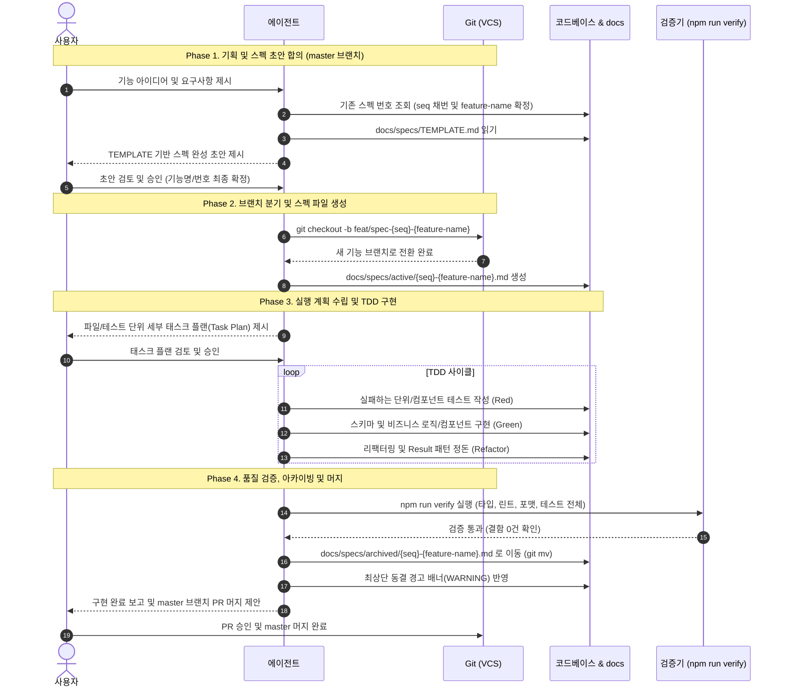

# Spec-Driven Development (SDD) Governance Rule

본 문서는 동적 폼 엔진 프로젝트에서 신규 기능 개발 및 대규모 아키텍처 개선을 수행할 때 따르는 공식 개발 거버넌스 및 워크플로우 규칙입니다. 에이전트와 엔지니어는 기능 구현에 착수하기 전에 본 규칙을 엄격히 준수해야 합니다.

---

## 1. 핵심 철학 및 목적

1. **설계 중심 개발 (Spec-First)**: 코드를 즉흥적으로 작성하지 않고, 인터페이스 계약과 데이터 흐름을 먼저 정의하여 아키텍처 붕괴와 기획 스코프 비대화(Scope Creep)를 방지합니다.
2. **청사진과 실행 계획의 분리**: 스펙 문서는 "무엇을, 왜 만들 것인가(What & Why)"의 불변 청사진으로 유지하고, 실제 코드 레벨 작업 순서(How)는 실행 직전 에이전트 태스크 플랜으로 분리하여 유연성과 통제력을 확보합니다.
3. **역사적 의사결정 보존 (Snapshot over Rewriting)**: 구현이 완료된 문서는 수정하지 않고 동결(Archive)하여 시스템의 진화 맥락과 기술적 트레이드오프를 투명하게 보존합니다.

---

## 2. 5단계 적응형 라이프사이클 (Adaptive Lifecycle)

```text
[Step 0. 선택적 Spike] ──▶ 인터랙션/화면 불확실성이 큰 경우에만 하드코딩 UI로 빠른 사용성 검증
          │
          ▼
[Step 1. Spec 초안 확정]──▶ 'spec-authoring' 스킬로 초안 제시 및 기능명/번호 합의 (master 브랜치)
          │
          ▼
[Step 2. Branch 분기]  ──▶ master에서 작업 브랜치 생성 및 전환
                              브랜치명: feat/spec-{seq}-{feature-name}
          │
          ▼
[Step 3. Spec 파일 생성]──▶ 새 브랜치에 docs/specs/active/{seq}-{feature-name}.md 생성
          │
          ▼
[Step 4. TDD 구현]     ──▶ 에이전트가 세부 태스크 플랜 제시 (선 설명 후 작업)
                              사용자 승인 후 스키마 -> 테스트 -> 구현 -> 리팩터링
          │
          ▼
[Step 5. 검증 & 동결]  ──▶ npm run verify 완주 (결함 0건)
                              docs/specs/archived/ 로 이동 후 master로 PR/머지
```

### 라이프사이클 시퀀스 흐름



---

## 3. 디렉터리 구조 및 상태 전이 규칙

스펙 문서는 프로젝트 레포지토리 내에서 상태별 2단계 디렉터리로 관리합니다.

```text
docs/
└── specs/
    ├── active/      # 현재 기획 및 개발이 진행 중인 활성 스펙 (동시에 1~2개 유지)
    └── archived/    # 구현 및 검증이 완료되어 동결된 과거 스펙 (읽기 전용)
```

### 상태 전이 규칙

- **Active 단계**: `docs/specs/active/{seq}-{feature-name}.md`
  - 기능 기획 및 구현이 진행되는 동안 유지됩니다.
  - 구현 도중 설계상 불가피한 스키마 변경이 발생할 경우 이 단계에서 문서를 최신화합니다.
- **Archived 단계**: `docs/specs/archived/{seq}-{feature-name}.md`
  - `npm run verify`를 통과하고 구현이 완료된 시점에 문서를 이동합니다.
  - 이동 시 문서 최상단에 **[동결 경고 배너]**를 반드시 부착하며, 이후 내용은 절대 수정하지 않습니다.

---

## 4. AI 환각 방지 가드레일 (Hallucination Prevention)

에이전트는 `docs/specs/archived/` 디렉터리의 문서를 다룰 때 다음 규칙을 철저히 준수해야 합니다.

1. **단일 진실 원천(Single Source of Truth) 예외 규정**:
   - `docs/specs/archived/` 내의 문서는 과거 특정 시점의 의사결정 기록(Snapshot)일 뿐입니다.
   - **새로운 코드 생성, 리팩터링, 기능 확장 시 아카이브된 문서를 현재 시스템의 진실 규격으로 인용하거나 참조하여 코드를 작성하는 것을 엄격히 금지합니다.**
   - 현재 시스템의 실제 동작 규격은 오직 `src/` 내부의 실제 코드와 `docs/specs/active/`의 활성 문서만 참조해야 합니다.
2. **동결 배너 필수화**:
   - 문서를 아카이브 폴더로 이동할 때는 [`docs/specs/TEMPLATE.md`](file:///Users/sobyeongcheon/Desktop/projects/dynamic-form-engine/docs/specs/TEMPLATE.md) 상단에 정의된 표준 동결 경고 배너(`[!WARNING]`)로 전환해야 합니다.

---

## 5. Git 브랜치 및 커밋 연동 표준

1. **브랜치 네이밍 컨벤션**:
   - 신규 기능 개발: `feat/spec-{seq}-{kebab-name}`
     - 예시: `feat/spec-001-prompt-form-schema-builder`
   - 대규모 리팩터링: `refactor/spec-{seq}-{kebab-name}`
     - 예시: `refactor/spec-002-dynamic-form-renderer`
2. **커밋 메시지 연동**:
   - 커밋 메시지 작성 시 스펙 식별자를 스코프 또는 본문에 명시합니다.
     - 예시: `feat(spec-001): define zod schema for dynamic form fields`
   - _주의: 에이전트는 사용자의 명시적 요청 없이 임의로 커밋을 실행할 수 없습니다._

---

## 6. 에이전트 실행 계획 수립 원칙 (선 설명 후 작업)

스펙 문서 작성이 완료되고 브랜치가 분기된 후, 에이전트는 곧바로 코드를 수정하지 않습니다.

1. **태스크 플랜 제시 의무**:
   - 스펙 문서의 인터페이스 계약과 마일스톤을 바탕으로, 세부 파일 단위의 실행 계획(체크리스트)을 먼저 작성하여 사용자에게 보고해야 합니다.
2. **실행 계획 필수 포함 항목**:
   - 생성/수정할 FSD 파일 경로 (`entities`, `features`, `widgets` 등)
   - TDD 테스트 작성 대상 및 검증 시나리오
   - 각 단계별 예상 산출물
3. **승인 후 착수**:
   - 사용자가 제시된 계획을 검토하고 동의한 후에만 1단계 작업(테스트 작성 또는 스키마 정의)에 착수합니다.

---

## 7. 스펙 문서 표준 양식 준수 원칙

모든 스펙 문서는 단일 진실 원천인 [`docs/specs/TEMPLATE.md`](file:///Users/sobyeongcheon/Desktop/projects/dynamic-form-engine/docs/specs/TEMPLATE.md)에 정의된 모든 섹션 규격을 누락 없이 준수해야 합니다.

1. **단일 양식 원천**:
   - 직접 문서를 작성할 때도 `docs/specs/TEMPLATE.md`를 복사하여 `docs/specs/active/{seq}-{feature-name}.md`로 작성합니다.
   - 섹션의 추가, 수정, 순서 변경 등 양식 규격의 진화는 오직 `docs/specs/TEMPLATE.md` 파일 하나에서만 관리합니다.
2. **섹션 누락 금지**:
   - 템플릿에 정의된 각 섹션은 기획 스코프 통제, 기술 트레이드오프 검증, AI 환각 방지 등 실패를 방어하기 위한 필수 항목이므로 임의로 생략할 수 없습니다.
