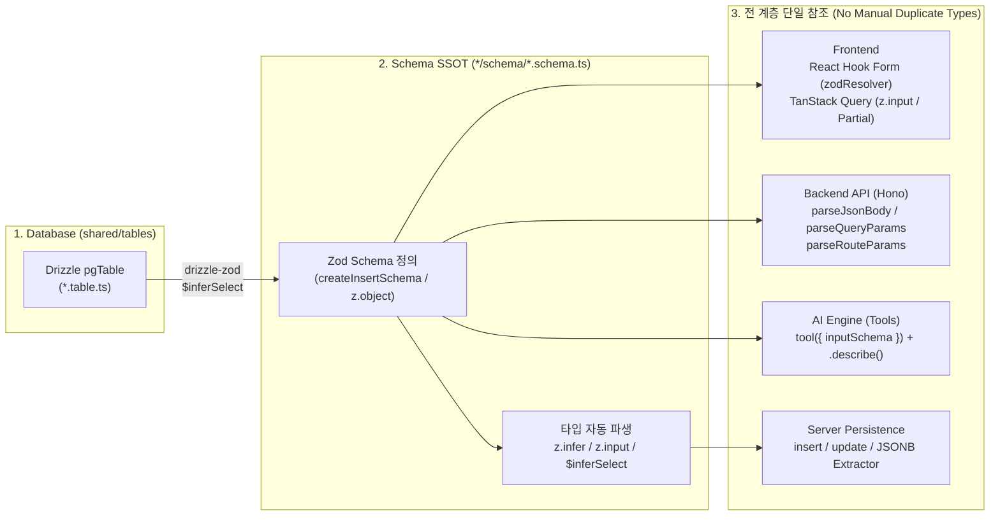

# Zod Schema Governance & Single Source of Truth (SSOT) Rule

본 문서는 동적 폼 엔진 프로젝트에서 데이터베이스(PostgreSQL/Drizzle), 백엔드(Hono/Route Handler), AI 엔진(Vercel AI SDK/Gemini Structured Outputs), 프론트엔드(React Hook Form/TanStack Query) 전 계층을 **Zod 스키마 단일 진실 원천(SSOT)**으로 관통시키기 위한 공식 거버넌스 규칙입니다.

---

## 1. 핵심 철학: Schema-First Single Source of Truth

> **"검증 규격(Zod Schema)은 단 한 곳에만 정의하고, 타입과 모든 경계 검증은 거기에서 파생한다."**

1. **선(先) 스키마 정의, 후(後) 타입 파생**:
   - 런타임 검증이 수반되는 모든 도메인 모델, API 요청 계약(Path/Query/Body), AI 도구 파라미터, JSONB 내부 구조는 반드시 **Zod 스키마(`schema/*.schema.ts`)를 먼저 정의**합니다.
   - TypeScript 정적 타입은 반드시 `z.infer<typeof schema>` 또는 `z.input<typeof schema>`로만 파생합니다.
2. **수동 인터페이스 중복 선언 절대 금지 (Zero Duplicate Types)**:
   - 이미 Zod 스키마가 존재하는 데이터 구조를 `types/*.types.ts`, `queries/*.query.ts`, `server/*.server.ts` 등에 수동 `interface` 또는 `type`으로 다시 작성하는 것을 엄격히 금지합니다.
   - 호출 시 기본값 필드를 생략할 수 있어야 하는 경우에도 별도 인터페이스를 만들지 않고 `Partial<z.infer<typeof schema>>` 또는 `z.input<typeof schema>`를 재사용합니다.

---

## 2. FSD 3계층 스키마 배치 기준 (Layer Placement)

모든 Zod 스키마는 반드시 각 계층의 `schema/*.schema.ts` 파일 내부에만 작성합니다. API 라우트(`src/app/api/**`)나 AI 도구 파일(`lib/tools/*.ts`) 내부에 인라인 `z.object(...)`를 작성하는 것을 금지합니다.

| 계층           | 파일 경로 패턴                              | 배치 대상 및 책임                                                                                                                                                                                                                       |
| :------------- | :------------------------------------------ | :-------------------------------------------------------------------------------------------------------------------------------------------------------------------------------------------------------------------------------------- |
| **`shared`**   | `src/shared/schema/*.schema.ts`             | 2개 이상의 `entities` 또는 `features`가 공통 참조하는 범용 원자 스키마 (`calendarDateStringSchema`, `submissionDateRangeFilterSchema`, 공용 필터/능력 스키마 등). FSD 수평 참조 금지 규칙을 준수하기 위한 최하위 공통 스키마 계층       |
| **`entities`** | `src/entities/[entity]/schema/*.schema.ts`  | 물리 DB 테이블 파생 스키마(`createInsertSchema`, `createSelectSchema`, `.omit(systemManagedFields)`), JSONB 컬럼 내부 구조 스키마(`coreFormFieldSchema`, `analysisBlockSchema`), 해당 엔티티 귀속 HTTP API 계약 스키마(Path/Query/Body) |
| **`features`** | `src/features/[feature]/schema/*.schema.ts` | 피처 전용 유스케이스 요청 페이로드 스키마(`navigatorRequestSchema`) 및 AI 에이전트 도구(`tool({ inputSchema })`)의 입력 스키마(`navigator-tools.schema.ts`)                                                                             |

- 각 슬라이스는 `index.ts`(또는 서버 전용 시 `server.ts`)를 통해서만 스키마와 파생 타입을 외부로 export합니다.

---

## 3. 타입 파생 3원칙 (`$inferSelect` vs `z.infer` vs `z.input` / `Partial`)

데이터의 수명주기와 신뢰 경계에 따라 다음 3가지 타입 파생 방식을 엄격히 구분하여 사용합니다:

1. **DB 조회 결과 모델 (Read Model) — `typeof table.$inferSelect`**:
   - 이미 DB 제약조건과 초기 입력 검증을 거쳐 영속화된 신뢰 데이터이므로, Drizzle ORM의 `typeof table.$inferSelect`를 단일 원천으로 사용합니다.
   - 내부 DB 조회 결과에 대해 불필요한 `schema.safeParse`를 반복 실행하여 CPU/메모리 오버헤드를 유발하지 않습니다(경계선 검증 원칙).
2. **검증 완료 출력 모델 (Validated Output Model) — `z.infer<typeof schema>`**:
   - API Route Handler, AI Tool `execute` 핸들러, Server 영속성 입력(`InsertForm`, `UpdateForm`, `SubmissionQueryParams`) 등 **런타임 파싱 및 `.default()`/`.transform()` 적용이 완료된 데이터**에 사용합니다.
3. **클라이언트/호출자 입력 모델 (Caller Input Model) — `z.input<typeof schema>` 또는 `Partial<...>`**:
   - `.default()`가 적용된 스키마(예: `mode.default("builder")`, `page.default(1)`, `limit.default(20)`)를 프론트엔드 쿼리 훅이나 서버 조회 함수의 인자로 받을 때 사용합니다.
   - 호출 측에서 기본값 속성을 생략할 수 있도록 `z.input<typeof schema>` 또는 `Partial<z.infer<typeof schema>>`로 타입을 파생하며, `Get*Params` / `Find*Options` 같은 별도 수동 인터페이스를 재선언하지 않습니다.

---

## 4. End-to-End 데이터 파이프라인 계약 (DB -> Server -> API -> AI -> Frontend)



### 계층별 경계 검증 및 연동 규격

1. **DB & JSONB 경계 (`src/shared/tables/*.table.ts` & 추출 함수)**:
   - `shared/tables`는 최하위 계층이므로 상위 도메인 스키마를 역참조할 수 없습니다. 따라서 테이블의 JSONB 컬럼은 느슨한 구조 인터페이스(`FormSchemaDefinition`, `AnalysisViewBlockRecord` 등)를 유지합니다.
   - 상위 계층(`entities`, `features`)에서 JSONB 컬럼(`schemaDefinition`, `blocks`, `data`)을 읽을 때는 무분별한 `as` 타입 단언을 지양하고, 반드시 엔티티가 제공하는 Zod 기반 검증/추출 함수(`extractActiveFields`, `extractAnalysisBlocks`, `validateSubmissionData` 등)를 통과시킵니다.
2. **API 경계 (`src/app/api/v1/**`)**:
   - Route Handler 및 Middleware 내부에 `z.object(...)` 인라인 스키마를 작성하는 것을 금지합니다.
   - 반드시 `entities/*/schema/` 또는 `features/*/schema/`에서 export한 스키마를 import하여 `@/app/api/v1/_lib/request-helpers`의 `parseRouteParams`, `parseQueryParams`, `parseJsonBody` 또는 `@/shared/lib/http`의 `parseRequestData`로 검증합니다.
   - 검증 실패 시 `z.flattenError(parsed.error).fieldErrors`가 포함된 표준 `400 BAD_REQUEST` 에러 응답으로 자동 귀결됩니다.
3. **AI Tool & Gemini Structured Outputs (`src/features/*/schema/*.schema.ts`)**:
   - AI 에이전트가 호출하는 모든 도구(`tool({ inputSchema })`)의 스키마는 각 필드에 **`.describe(...)`를 필수로 명시**하여 LLM이 파라미터 의미와 제약조건을 정확히 이해하도록 합니다.
   - Gemini Structured Outputs 및 JSON Schema 변환 호환성을 유지하기 위해 과도하게 중첩된 `z.union`이나 복잡한 재귀 타입 대신 **평탄화된(Flattened) `z.object(...)` + `.superRefine(...)`** 패턴을 표준으로 사용합니다.
4. **Frontend (`hooks/`, `queries/`)**:
   - React Hook Form을 사용하는 폼은 `zodResolver(schema)`를 통해 서버와 동일한 Zod 스키마로 실시간 클라이언트 검증을 수행합니다.
   - TanStack Query 훅(`*.query.ts`, `*.mutation.ts`)은 요청/응답 타입을 스키마 파일의 파생 타입(`InsertForm`, `UpdateForm`, `SubmissionQueryInput` 등)에서 직접 가져와 사용합니다.

---

## 5. 정적 분석 가드레일 (ESLint Enforced)

`eslint.config.mjs`의 `no-restricted-imports` 규칙을 통해 스키마 정의 위치 단일화를 기계적으로 강제합니다:

- **차단 대상**: `src/**/schema/*.schema.ts` 및 지정된 코어 인프라 파일(`src/shared/lib/http/server.ts`, `src/shared/lib/date/date.ts`, `src/app/api/v1/_lib/request-helpers.ts`), 테스트 파일(`*.test.ts`, `*.test.tsx`, `*.spec.ts`)을 제외한 모든 `src/**` 파일에서 `"zod"` 및 `"drizzle-zod"`의 직접 import가 에러로 차단됩니다.
- **허용되는 사용법**:
  - React Hook Form 연결 시 `hooks/` 세그먼트에서 `@hookform/resolvers/zod`의 `zodResolver`를 import하고, 스키마 인스턴스 자체는 `entities` 또는 `features`의 `index.ts`에서 가져옵니다.
  - `types/*.types.ts`, `queries/`, `server/`, `lib/`, `ui/`, `app/api/` 파일은 모두 `schema/*.schema.ts`가 export한 스키마 객체와 파생 타입만 import하여 사용합니다.

---

## 6. 안티패턴 vs 권장 패턴 (Code Comparison)

### 1) 수동 인터페이스 중복 선언 금지

```typescript
// [Bad] 스키마가 있는데 queries/ 또는 types/에 수동 인터페이스를 중복 선언
// src/entities/form-submission/queries/use-form-submissions.query.ts
export interface GetPaginatedSubmissionsParams {
  page?: number;
  limit?: number;
  sort?: string;
  // 나중에 스키마에 timezone이 추가되어도 누락될 위험
}

// [Good] Zod 스키마에서 파생된 입력 타입을 단일 진실 원천으로 재사용
// src/entities/form-submission/schema/submission-query.schema.ts
export const submissionQuerySchema = z.object({
  page: z.coerce.number().int().min(1).default(1),
  limit: z.coerce.number().int().min(1).max(100).default(20),
  sort: z.string().optional().default("createdAt:desc"),
  timezone: optionalNonEmptyString(z.string().min(1)),
});
export type SubmissionQueryParams = z.infer<typeof submissionQuerySchema>;
export type SubmissionQueryInput = Partial<SubmissionQueryParams>;

// src/entities/form-submission/queries/use-form-submissions.query.ts
import type { SubmissionQueryInput } from "../schema/submission-query.schema";
export type GetPaginatedSubmissionsParams = SubmissionQueryInput;
```

### 2) API 라우트 및 AI 도구 내 인라인 스키마 분리

```typescript
// [Bad] API 라우트나 도구 파일에 z.object를 직접 선언
// src/app/api/v1/forms/forms-routes.ts
import { z } from "zod"; // ESLint 에러 차단 대상
const publishFormBodySchema = z.object({ isPublished: z.boolean().default(true) });

// [Good] 엔티티 또는 피처의 schema/*.schema.ts에 정의 후 Public API로 import
// src/entities/form/schema/form.schema.ts
export const publishFormBodySchema = z.object({
  isPublished: z
    .boolean({ message: "발행 여부(isPublished)는 불리언 값이어야 합니다." })
    .default(true),
});
export type PublishFormBody = z.infer<typeof publishFormBodySchema>;

// src/app/api/v1/forms/forms-routes.ts
import { publishFormBodySchema } from "@/entities/form";
const { isPublished } = await parseJsonBody(c, publishFormBodySchema);
```

### 3) 복수 엔티티 공용 스키마의 `shared/schema` 하향

```typescript
// [Bad] 각 엔티티에서 날짜 문자열 정규식을 각자 다르게 작성
// src/entities/analysis-view/schema/analysis-view.schema.ts
startDate: z.string().regex(/^\d{4}-\d{2}-\d{2}$/).optional(), // "2026-02-31"이 통과됨

// [Good] shared/schema에 공용 원자 스키마를 정의하고 모든 엔티티가 공유
// src/shared/schema/date.schema.ts
export const calendarDateStringSchema = z
  .string()
  .regex(/^\d{4}-\d{2}-\d{2}$/, "날짜는 YYYY-MM-DD 형식이어야 합니다.")
  .refine(isValidCalendarDate, "유효한 달력 날짜가 아닙니다.");

// src/entities/analysis-view/schema/analysis-view.schema.ts
import { calendarDateStringSchema } from "@/shared/schema";
startDate: calendarDateStringSchema.optional(),
```
