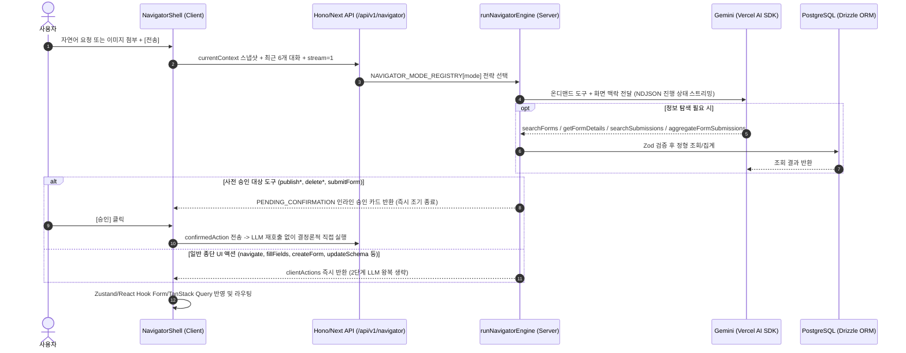

# AI Dynamic Form Builder & Runtime Engine

[](https://github.com/ssogle/dynamic-form-engine/actions/workflows/ci.yml)
[](LICENSE)

> **자연어 기반 관계형 도메인 폼 빌더, 비정형 데이터 정제 런타임 및 결정론적 데이터 분석 엔진**  
> Next.js 16 (App Router) · FSD(Feature-Sliced Design) · SDD(Spec-Driven Development) · TDD Harness

---

## 1. Executive Summary

본 프로젝트는 단순 설문 생성기를 넘어, **자연어로 관계형 도메인 스키마를 설계(Builder)하고, 정형/멀티모달 비정형 데이터를 안전하게 수집·관리(Consumer)하며, PostgreSQL 서버 집계 결과를 바탕으로 리포트와 차트(Analyst)까지 완결하는 통합 3-Workspace 데이터 엔진**입니다.

LLM 도입 시 빈번히 발생하는 **환각(Hallucination), 수치 오계산, 스키마·데이터 무결성 파괴, 비정형 출력 오류, 불필요한 토큰·지연 비용**을 애플리케이션 레벨과 엔지니어링 하네스(Harness)로 통제합니다:

1. **On-Demand Tool Calling & HITL Gate**: 사전 전량 컨텍스트 덤프 대신 온디맨드 조회 도구(`searchForms`, `getFormDetails`, `searchSubmissions`, `getRelatedSubmissions`)와 종단 스텝 조기 종료(`shouldStopAfterTerminalStep`)로 지연과 토큰을 절감하며, 발행·삭제·제출/수정 저장 전 인라인 `[승인]`/`[취소]` 사전 확인 루프를 강제합니다.
2. **Data Integrity & Schema Governance**: 소프트 삭제(`deletedAt`), `version` 컬럼 기반 낙관적 락(`409 Conflict`), 발행 중 폼 수정 보호, 응답 보유 폼의 파괴적 스키마 변경 차단, 단일 진실 원천 `FIELD_CAPABILITY_BY_TYPE` 필터·집계 규격을 적용했습니다.
3. **Deterministic Server Analytics**: LLM 암산을 금지하고 Drizzle + PostgreSQL 집계(`aggregateFormSubmissions`) 및 결정론적 교차 연산기(`computeSeriesMetric`) 결과만을 근거로 `text`, `table`, `chart` 블록 분석 뷰를 생성합니다.

---

## 2. 3-Workspace Product Architecture

```text
/ (Landing Gateway + 자동 회전 3D 온톨로지 배경)
├── /builder   (Builder Workspace: 스키마 설계, 라이브 프리뷰, 3D 도메인 관계 그래프)
├── /consumer  (Consumer Workspace: 데이터 입력/수정/검색, 멀티모달 Vision 입력, 가상화 테이블)
└── /analyst   (Analyst Workspace: 서버 집계 기반 블록형 분석 뷰 문서 작성 및 발행)
```

| 워크스페이스 | 주요 경로                                                                                                   | 핵심 기능 및 책임                                                                                                                                                                                                                                         |
| :----------- | :---------------------------------------------------------------------------------------------------------- | :-------------------------------------------------------------------------------------------------------------------------------------------------------------------------------------------------------------------------------------------------------- |
| **Landing**  | `/`                                                                                                         | DB 무조회 자동 회전 3D 온톨로지 배경(`LandingOntologyBackground`) 및 3개 역할 포털 게이트웨이                                                                                                                                                             |
| **Builder**  | `/builder/forms`, `/builder/forms/[id]`                                                                     | 9종 도메인 필드(`text`, `textarea`, `number`, `select`, `radio`, `checkbox`, `date`, `switch`, `relation`) 설계, `primaryFieldId` 지정, 다중 뷰 프리뷰, `/builder/forms` 3D 관계 그래프 + 목록 스플릿 뷰(`SpriteText` 상시 라벨, 방향성 파티클)           |
| **Consumer** | `/consumer`, `/consumer/forms/[id]`, `/new`, `/submissions/[submissionId]`, `/edit`, `/consumer/views/[id]` | 발행된 폼 입력/수정, 영수증/명세서 이미지 첨부 Gemini Vision 자동 입력(`fillFields`), 제출/수정 저장 HITL 승인, TanStack Virtual 테이블 + URL 동기화 통합 필터/기간/정렬, `relations` 역참조 목록, 공유 분석 뷰 열람                                      |
| **Analyst**  | `/analyst/views`, `/analyst/views/[id]`                                                                     | PostgreSQL 서버 레벨 `count`/`sum`/`avg`/`min`/`max` · 시계열 · `relation`/옵션 기준 그룹 집계, Zero-fill 교차 연산, Recharts(`bar`, `line`, `pie`) 차트 + 테이블 + 마크다운 요약 블록 편집·원자적 일괄 갱신(`SET_ALL_BLOCKS`) 및 원천 `sourceLinks` 연동 |

> [!NOTE]
> `/builder`, `/consumer`, `/analyst` 작업 공간은 좌측 상주형 AI Navigator 패널(`w-80 lg:w-96`), 라이브 캔버스, 가상화 데이터 테이블, 3D 그래프의 사용성을 보장하기 위해 **데스크톱(`1024px` 이상) 전용**으로 설계되었으며, `1024px` 미만 뷰포트 진입 시 `WorkspaceSplitShell`이 데스크톱 안내 가드 카드를 표시합니다.

---

## 3. System Architecture & Runtime Pipeline

### 1) AI Navigator 오케스트레이션 (`POST /api/v1/navigator?stream=1`)



### 2) 데이터베이스 물리 스키마 (`src/shared/tables/`)

- `forms.table.ts`: 폼 메타데이터, JSONB `schemaDefinition` (`primaryFieldId` + `fields`), `publishedAt`, `version`(낙관적 락), `deletedAt`
- `form-submissions.table.ts`: 제출 응답 JSONB `data`, `formId` FK(CASCADE), `version`, `deletedAt`
- `relations.table.ts`: `relation` 필드 저장 시 동기화되는 경량 엣지 인덱스 (`sourceFormId`, `sourceSubmissionId`, `targetSubmissionId`, `fieldId`) — JSONB 풀 스캔 없이 단건 상세 역참조 및 AI `getRelatedSubmissions` 추적 지원
- `analysis-views.table.ts`: 블록(`text`, `table`, `chart`) 기반 분석 뷰 JSONB `blocks`, `publishedAt`, `version`, `deletedAt`

### 3) API 엔드포인트 (`src/app/api/v1/`)

- `GET/POST/PATCH/DELETE /api/v1/forms/[[...route]]` (Hono Router)
- `GET/POST/PATCH/DELETE /api/v1/forms/:formId/submissions` 및 필터·집계 라우트 (Hono Router)
- `GET/POST/PATCH/DELETE /api/v1/analysis-views/[[...route]]` (Hono Router)
- `GET /api/v1/relations` (역참조 연결 내역 조회)
- `POST /api/v1/navigator` (NDJSON 스트리밍 & JSON 응답 AI 실행)

---

## 4. Tech Stack

| 계층                      | 채택 기술                                                                                                                             |
| :------------------------ | :------------------------------------------------------------------------------------------------------------------------------------ |
| **Framework / UI**        | Next.js `16.4.6` (App Router, Turbopack), React `19.3.0`, TypeScript `5` (Strict), Tailwind CSS `v4`, shadcn/ui, Lucide Icons, Sonner |
| **State / Query / Table** | TanStack Query `v5`, TanStack Table `v8`, TanStack Virtual `v3`, React Hook Form `v7`, Zod `v4`, Zustand `v5`                         |
| **Visualization**         | Recharts `v3` (Bar/Line/Pie), `react-force-graph-3d` + `three-spritetext` (WebGL 3D 관계 그래프), `react-markdown` + `remark-gfm`     |
| **Backend / DB**          | Hono `v4`, Drizzle ORM + `drizzle-zod`, PostgreSQL (`postgres`)                                                                       |
| **AI Runtime**            | Vercel AI SDK (`ai` `v7`) + `@ai-sdk/google` (`gemini-flash-lite-latest`)                                                             |
| **Test / Quality**        | Vitest `v3`, ESLint (`eslint-plugin-boundaries`, `eslint-plugin-check-file`), Prettier, Husky, Commitlint                             |

---

## 5. Architecture & Engineering Harness

단방향 결합도와 관심사 분리를 보장하기 위해 **FSD(Feature-Sliced Design)** 레이어 구조를 따릅니다:

```text
src/
├── app/          # Next.js App Router 진입점, 워크스페이스 쉘, Hono/Route Handlers
├── widgets/      # 복합 UI 패널 (navigator-shell, builder-form-preview)
├── features/     # 유스케이스 기능 슬라이스 (execute-navigator-action, manage-builder-forms,
│                 #   manage-form-submissions, manage-analysis-views, browse-published-forms,
│                 #   render-dynamic-form, render-analysis-view)
├── entities/     # 핵심 도메인 엔티티, Zod 스키마, React Query 훅, 서버 리포지토리 (form, form-submission, analysis-view)
└── shared/       # 공용 UI(shadcn/ui, 배럴 금지), DB 테이블 DDL, HTTP/Date/AI/Zod 유틸리티
```

| 분류              | 가드레일 / 규칙                                              | 핵심 목적                                                                               | 문서                                                                                                                |
| :---------------- | :----------------------------------------------------------- | :-------------------------------------------------------------------------------------- | :------------------------------------------------------------------------------------------------------------------ |
| **FSD & 네이밍**  | `eslint-plugin-boundaries`, `check-file`                     | 레이어 단방향 의존성, Public API(`index.ts`/`server.ts`) 강제, `kebab-case` 통일        | [.agents/rules/fsd-architecture-rule.md](.agents/rules/fsd-architecture-rule.md)                                    |
| **코딩 패러다임** | `no-restricted-syntax`, Result 패턴                          | 함수형 지향(`class`/`this` 금지), `{ data, error }` 반환, YAGNI                         | [.agents/rules/coding-paradigm-rule.md](.agents/rules/coding-paradigm-rule.md)                                      |
| **Zod SSOT**      | Schema-First 거버넌스                                        | `tables/*.table.ts` vs `schema/*.schema.ts` vs `types/*.types.ts` 역할 분리             | [.agents/rules/zod-schema-governance-rule.md](.agents/rules/zod-schema-governance-rule.md)                          |
| **날짜/시간**     | `no-restricted-imports` + `@/shared/lib/date` + `sql`now()`` | Store in UTC, Display in Local, 중앙 DB 시계 권한, 서드파티 직접 import 차단            | [.agents/rules/date-and-time-rule.md](.agents/rules/date-and-time-rule.md)                                          |
| **UI & 스타일링** | `@/shared/ui` 직접 임포트, Tailwind v4 시맨틱 토큰           | 배럴 파일 금지, 시스템 팝업(`alert`/`confirm`) 금지, `Thin View` + `use-*.hook.ts` 분리 | [.agents/rules/ui-and-styling-rule.md](.agents/rules/ui-and-styling-rule.md)                                        |
| **테스트 전략**   | Vitest (`*.test.ts`)                                         | 순수 비즈니스 로직·스키마·스토어·서버 단위 테스트 집중 (`*.test.tsx` UI 테스트 배제)    | [.agents/rules/testing-strategy-rule.md](.agents/rules/testing-strategy-rule.md)                                    |
| **SDD & Git**     | `docs/specs/{active,archived}`, Husky + Commitlint           | 스펙 선설계 후 구현·완료 시 아카이빙 동결, GitHub Flow 및 PR 템플릿 준수                | [SDD 규칙](.agents/rules/spec-driven-development-rule.md) / [Git 규칙](.agents/rules/git-commit-automation-rule.md) |
| **CI 자동 검증**  | GitHub Actions (`.github/workflows/ci.yml`)                  | `master` Push 및 PR 단위 `npm run verify`(타입·린트·포맷·전체 단위 테스트) 자동 게이트  | [ci.yml](.github/workflows/ci.yml)                                                                                  |

### Agentic Engineering Workflow (Harness-Driven Development)

본 프로젝트는 AI 코딩 에이전트를 단순 코드 생성기가 아닌 **규칙과 테스트로 통제되는 협업 파트너**로 운영하기 위해 다음 4단계 하네스 루프를 적용했습니다:

1. **명세 선행(Spec-First)**: 구현 전 [AGENTS.md](AGENTS.md)와 `.agents/skills/spec-authoring/` 스킬을 통해 Goals/Non-Goals, FSD 배치, Zod 계약을 합의하고 `docs/specs/active/`에 기록합니다.
2. **정적 가드레일(Static Guardrails)**: `eslint-plugin-boundaries`, `check-file`, `no-restricted-imports`(날짜 라이브러리 직접 import 차단), `no-restricted-syntax`(`class`/`this` 금지)로 아키텍처 드리프트를 컴파일·린트 단계에서 즉시 차단합니다.
3. **로직 중심 TDD(High-ROI Unit Tests)**: 외부 인프라(DB/LLM)에 의존하지 않는 순수 비즈니스 로직·스키마·스토어·서버 계약을 Vitest 단위 테스트로 고정합니다.
4. **PR 단위 CI 게이트 및 아카이빙**: `npm run verify` 통과 후 완료된 스펙을 `docs/specs/archived/`로 동결하고, GitHub Actions CI를 통과한 PR만 `master`에 머지합니다.

---

## 6. Spec-Driven Evolution (Archived Specs 001 ~ 017)

완료된 모든 기능 명세와 기술 의사결정 이력은 [`docs/specs/archived/`](docs/specs/archived/)에 읽기 전용으로 보존되어 있습니다.

| 번호 | 스펙 문서                                                                                                                | 핵심 구현 내용                                                                                                               |
| :--- | :----------------------------------------------------------------------------------------------------------------------- | :--------------------------------------------------------------------------------------------------------------------------- |
| 001  | [001-autonomous-navigator-core.md](docs/specs/archived/001-autonomous-navigator-core.md)                                 | 동적 폼 엔진 기반 및 AI Builder 프로토타입 구축                                                                              |
| 002  | [002-consumer-form-submission-core.md](docs/specs/archived/002-consumer-form-submission-core.md)                         | 컨슈머 동적 폼 렌더링, Zod 동적 검증 및 제출 파이프라인                                                                      |
| 003  | [003-on-demand-navigator-engine.md](docs/specs/archived/003-on-demand-navigator-engine.md)                               | 전략 레지스트리 및 온디맨드 도구 호출 기반 AI 오케스트레이션 통합                                                            |
| 004  | [004-consumer-data-domain-workspace.md](docs/specs/archived/004-consumer-data-domain-workspace.md)                       | TanStack Virtual 기반 컨슈머 데이터 워크스페이스 및 상세/수정 CRUD                                                           |
| 005  | [005-relational-domain-link-and-select-options.md](docs/specs/archived/005-relational-domain-link-and-select-options.md) | `relation` 외래키 연결, `relations` 인덱스 테이블, `select` 옵션 메타데이터                                                  |
| 006  | [006-hono-api-router.md](docs/specs/archived/006-hono-api-router.md)                                                     | `/api/v1/*` Hono API 라우터 도입 및 검증 미들웨어 표준화                                                                     |
| 007  | [007-analyst-knowledge-studio.md](docs/specs/archived/007-analyst-knowledge-studio.md)                                   | 서버 집계 기반 Analyst Studio 및 `text`/`table`/`chart` 분석 뷰                                                              |
| 008  | [008-unified-field-filter-engine.md](docs/specs/archived/008-unified-field-filter-engine.md)                             | `FIELD_CAPABILITY_BY_TYPE` 통합 필드/기간/정렬 필터 엔진                                                                     |
| 009  | [009-workspace-app-switcher-layout.md](docs/specs/archived/009-workspace-app-switcher-layout.md)                         | 글로벌 앱 바 및 3-Workspace 좌우 분할 레이아웃 통일                                                                          |
| 010  | [010-builder-form-multi-view-preview.md](docs/specs/archived/010-builder-form-multi-view-preview.md)                     | 빌더 다중 뷰 미리보기(폼/목록/상세/분석) 지원                                                                                |
| 011  | [011-data-integrity-and-schema-governance.md](docs/specs/archived/011-data-integrity-and-schema-governance.md)           | `version` 낙관적 락, 발행 폼 수정 보호, `select`/`relation` 배열 포맷 통일                                                   |
| 012  | [012-consumer-ai-accuracy-and-filtering.md](docs/specs/archived/012-consumer-ai-accuracy-and-filtering.md)               | 상대 날짜 컨텍스트, 옵션 코드 정규화, `submitForm` 선검증, 목록 필터·검색 도구                                               |
| 013  | [013-ai-chat-multimodal-hitl-and-ux-polish.md](docs/specs/archived/013-ai-chat-multimodal-hitl-and-ux-polish.md)         | 마크다운 통합 렌더러, Gemini Vision 이미지 입력, HITL 사전 승인 카드, 역참조 테이블 통합                                     |
| 014  | [014-relation-graph-visualization.md](docs/specs/archived/014-relation-graph-visualization.md)                           | `react-force-graph-3d` + `three-spritetext` 3D 관계 그래프, 랜딩 3D 배경, 제출 HITL·지연 최적화, 모바일 가드                 |
| 015  | [015-workspace-ux-shell-and-focus-polish.md](docs/specs/archived/015-workspace-ux-shell-and-focus-polish.md)             | 랜딩 헤더·다크 테마 통합, `BackLink` 통일, AI 패널 좌/우 도킹·`Cmd+K`, 3D 그래프 드래그/시점·블록 포커스 개선                |
| 016  | [016-unified-table-and-ai-sort-engine.md](docs/specs/archived/016-unified-table-and-ai-sort-engine.md)                   | 관계형 피커·선택결과·상세 테이블 `ManageFormSubmissions` 통합, 정렬 칩·UUID 스키마 통일, AI 파생 지표·`SORT_BLOCK_DATA` 정렬 |
| 017  | [017-studio-ux-preview-and-filter-unification.md](docs/specs/archived/017-studio-ux-preview-and-filter-unification.md)   | 랜딩 데모 안내, 발행 상태 UI 통일, 빌더·분석가 AI 편집 동선, 프리뷰·드릴다운 필터 통합                                       |

---

## 7. Intentional Scope Boundaries & Future Extensions

핵심 도메인 엔진 검증에 집중하기 위해 아래 항목은 의도적으로 스코프에서 분리했으며, 현행 구조 위에서 자연스럽게 확장 가능하도록 경계를 유지했습니다:

- **인증 및 멀티테넌트(Auth/RBAC)**: 단일 워크스페이스 프로토타입으로 인증 계층 제외 (Hono 미들웨어 및 테이블 테넌트 키 추가로 확장 가능)
- **버전 변경 이력 & 시점 롤백 UI**: `version` 기반 낙관적 락(`409 Conflict`)은 구현되었으며, append-only 이력 테이블 및 diff 롤백 UI는 운영 단계 확장에 위임
- **조건부 상태 전이·자동화 워크플로우 엔진**: 도메인 데이터 수집·관계·분석 레이어와 분리해 향후 제출 이벤트 기반 룰 엔진으로 확장
- **모바일 반응형 워크스페이스 / 다국어(i18n) / 추가 차트 유형**: 한국어 단일화 및 데스크톱(`1024px+`) 전용 하드 가드 적용, 차트는 핵심 3종(`bar`, `line`, `pie`)에 집중

---

## 8. Getting Started

### 1) Requirements

- Node.js 20.x 이상
- npm 10.x 이상
- PostgreSQL 데이터베이스 (로컬 Docker, Supabase, Neon 등)

### 2) Environment Variables

```bash
cp .env.example .env.local
```

```env
DATABASE_URL=postgresql://postgres:[PASSWORD]@[HOST]:[PORT]/[DATABASE]
DIRECT_URL=postgresql://postgres:[PASSWORD]@[HOST]:[PORT]/[DATABASE]
GEMINI_API_KEY=your_gemini_api_key_here
```

### 3) Database Setup & Run

```bash
npm install
npm run db:migrate
npm run dev
```

### 4) Available Scripts

| 명령어                  | 설명                                                                         |
| :---------------------- | :--------------------------------------------------------------------------- |
| `npm run dev`           | Next.js 로컬 개발 서버 실행 (Turbopack)                                      |
| `npm run build`         | 프로덕션 빌드 생성                                                           |
| `npm run start`         | 프로덕션 서버 실행                                                           |
| `npm run verify`        | `[통합 검증]` 타입체크 -> ESLint -> Prettier 체크 -> Vitest 전체 테스트 완주 |
| `npm run check`         | `[정적 검사]` `typecheck` + `lint` + `format:check`                          |
| `npm run fix`           | `[자동 교정]` Prettier 포맷팅 및 ESLint 자동 수정                            |
| `npm test`              | Vitest 단위 테스트 1회 실행                                                  |
| `npm run test:watch`    | 파일 변경 감지 실시간 TDD 루프                                               |
| `npm run test:coverage` | V8 기반 테스트 커버리지 리포트 생성                                          |
| `npm run typecheck`     | TypeScript 정적 타입 검사 (`tsc --noEmit`)                                   |
| `npm run lint`          | ESLint 검사 (FSD 경계 및 파일 컨벤션 포함)                                   |
| `npm run db:generate`   | Drizzle 마이그레이션 SQL 생성                                                |
| `npm run db:migrate`    | Drizzle 마이그레이션 적용                                                    |
| `npm run db:push`       | 스키마 직접 푸시 (개발용)                                                    |
| `npm run db:studio`     | Drizzle Studio 실행                                                          |
