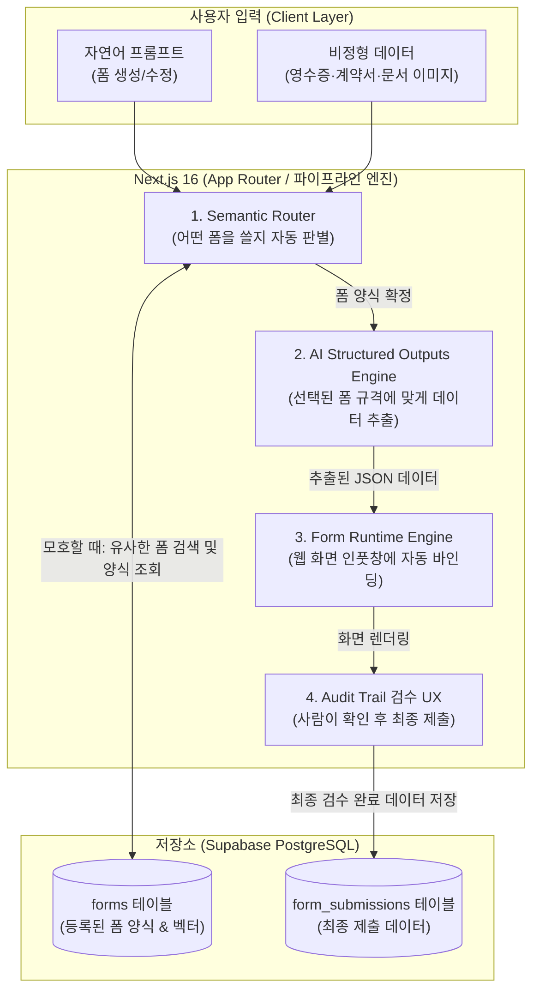

# AI Dynamic Form Builder & Runtime Engine

> **자연어 기반 동적 폼 스키마 빌더 및 비정형 데이터 정제 런타임 엔진**  
> FSD(Feature-Sliced Design) 아키텍처와 엔지니어링 하네스(Harness) 가드레일 기반 프로토타입

---

## 1. Executive Summary

사내 백오피스 및 B2B SaaS 환경에서 폼(Form) 관리 비용과 비정형 데이터 입력 공수는 가장 빈번한 생산성 병목 중 하나입니다. 또한 대형 언어 모델(LLM)을 업무 시스템에 도입할 때 발생하는 **환각(Hallucination), 비정형 출력 포맷 깨짐, 불필요한 토큰 비용 낭비**는 프로덕션 안착을 가로막는 주요 장애물입니다.

본 프로젝트는 이 문제를 해결하기 위해 두 가지 핵심 축으로 설계되었습니다:

1. **Form Builder Engine**: 자연어 프롬프트를 통해 정형화된 **JSON Schema / Zod 스키마**를 동적으로 생성하고 실시간 렌더링 및 커스텀을 지원
2. **Dynamic Runtime Parser**: 영수증, 계약서, 메모 등 비정형 텍스트·이미지를 입력받아 **Gemini Structured Outputs** 규격으로 파싱하고 폼 필드에 1:1 자동 바인딩(Human-in-the-loop 검수)

단순한 AI API 연동 토이 프로젝트를 넘어, **엄격한 FSD 경계 검증, TDD 테스트 하네스, UI/타입 가드레일**을 선제적으로 구축하여 엔터프라이즈 환경에 즉시 확장 가능한 아키텍처를 제시합니다.

---

## 2. System Architecture



---

## 3. Engineering Harness & Governance

본 저장소는 개발 생산성과 아키텍처 정합성을 기계적으로 통제하기 위한 **엔지니어링 하네스(Harness)** 가드레일을 준수합니다.

| 분류              | 가드레일 도구                    | 통제 목적 및 효과                                                                                               | 규칙 문서                                                                                  |
| :---------------- | :------------------------------- | :-------------------------------------------------------------------------------------------------------------- | :----------------------------------------------------------------------------------------- |
| **아키텍처 경계** | `eslint-plugin-boundaries`       | FSD 레이어 간 단방향 의존성 강제, 세부 구현 직통 import 차단 및 Public API(`index.ts`) 강제                     | [.agents/rules/fsd-architecture-rule.md](.agents/rules/fsd-architecture-rule.md)           |
| **코딩 패러다임** | ESLint `no-restricted-syntax`    | 함수형 지향, `class` 및 `this` 키워드 원천 차단, `{ data, error }` Result 패턴 준수                             | [.agents/rules/coding-paradigm-rule.md](.agents/rules/coding-paradigm-rule.md)             |
| **파일 컨벤션**   | `eslint-plugin-check-file`       | 전역 `kebab-case` 파일/폴더 네이밍 강제 (OS 간 대소문자 경로 불일치 원천 차단)                                  | [.agents/rules/fsd-architecture-rule.md](.agents/rules/fsd-architecture-rule.md)           |
| **타입 가드레일** | TypeScript Strict Options        | `noUncheckedIndexedAccess`, `exactOptionalPropertyTypes` 적용으로 동적 데이터 런타임 `undefined` 결함 사전 방어 | [tsconfig.json](tsconfig.json)                                                             |
| **테스트 하네스** | Vitest + React Testing Library   | ROI 중심 테스트 전략 (도메인 변환기 및 복합 인터랙션 중심 TDD 루프 확립)                                        | [.agents/rules/testing-strategy-rule.md](.agents/rules/testing-strategy-rule.md)           |
| **UI 거버넌스**   | Tailwind CSS v4 + shadcn/ui      | `@/shared/ui` 최우선 재사용, 시맨틱 토큰(`bg-background`, `text-foreground`) 필수화                             | [.agents/rules/ui-and-styling-rule.md](.agents/rules/ui-and-styling-rule.md)               |
| **커밋 거버넌스** | Husky + lint-staged + Commitlint | Conventional Commits 규격 강제, 빠른 커밋 리듬 유지를 위한 점진적 검증                                          | [.agents/rules/git-commit-automation-rule.md](.agents/rules/git-commit-automation-rule.md) |

---

## 4. Architecture Layers (Feature-Sliced Design)

단방향 결합도와 관심사 분리를 보장하기 위해 **FSD(Feature-Sliced Design)** 레이어 원칙을 기반으로 모듈화됩니다:

```
src/
├── app/          # 진입점: Next.js App Router 라우팅, 전역 레이아웃 및 BFF 핸들러
├── widgets/      # 결합 블록: 독립적으로 완결된 대형 복합 UI 패널
├── features/     # 기능 단위: 사용자 인터랙션 및 유스케이스 로직 (폼 빌더, 런타임 검수기)
├── entities/     # 도메인 모델: 폼 스키마 규격 정의, 비즈니스 핵심 엔티티 및 스키마 변환기
└── shared/       # 공통 인프라: 재사용 UI 키트(shadcn/ui), 유틸리티, API 클라이언트 인스턴스
```

- **Public API 거버넌스**: `entities`, `features`, `widgets` 레이어는 슬라이스 루트의 `index.ts`를 통해서만 외부 참조를 허용하며, 내부 세부 파일로의 직통 참조는 ESLint 단계에서 엄격히 차단됩니다.
- **UI 번들 최적화 (No Barrel)**: `shared/ui`는 번들 오염 방지 및 트리쉐이킹을 위해 배럴 파일을 두지 않고 개별 직접 임포트(`@/shared/ui/button`) 방식을 강제합니다.

---

## 5. Key Technical Decisions & Trade-offs

### 1. 단일 Next.js 레포지토리 (vs 모노레포)

- **결정**: Turborepo 등 모노레포 오버헤드를 배제하고, 단일 Next.js 앱 내 라우트 그룹 및 FSD 모듈화로 해결.
- **이유**: 빌드 파이프라인 구성 및 패키지 간 의존성 관리에 드는 인프라 공수를 아끼고, **동적 폼 렌더링 엔진과 AI 파이프라인 검증**이라는 핵심 문제에 집중.

### 2. Zod & Gemini Structured Outputs 기반 런타임 타입 방어

- **결정**: LLM 응답을 자유 텍스트가 아닌 `responseSchema`를 통한 JSON 형식으로 강제하고, 프론트엔드 유입 전 `zod.safeParse()` 검증.
- **이유**: AI의 환각(Hallucination)으로 인한 잘못된 데이터가 폼 상태(State)로 침투하는 것을 원천 차단.

### 3. 유사도 임계치(Threshold) 기반 방어적 RAG 라우팅

- **결정**: 모든 요청에 무분별하게 벡터 검색을 태우지 않고, 모호한 자연어/이미지 인입 시에만 `pgvector` 코사인 유사도 검색 가동.
- **이유**: 불필요한 임베딩 호출 비용을 줄이고, 1위 유사도가 기준치(0.75) 미만일 경우 Fallback UI로 유도하여 오작동 방지.

### 4. TDD 하네스 분리 (개발 실시간 vs 커밋 경량화)

- **결정**: 커밋 단계(`pre-commit`)에서는 `lint-staged`와 `typecheck`만 실행하여 빠른 커밋 리듬(~2초)을 보존하고, 테스트는 개발 시 `npm run test:watch`로 실시간 피드백 수행.
- **이유**: 테스트 스위트 증가 시 커밋 지연으로 인한 개발 생산성 저하 및 `--no-verify` 우회 습관 방지.

### 5. 국제화(i18n) 지연 결정 (YAGNI 원칙 준수)

- **결정**: 초기 단계에서 i18n 라이브러리(`next-intl`) 세팅을 배제하고 단일 언어로 핵심 도메인에 집중.
- **이유**: 현재 프로토타입의 최우선 가치는 B2B 동적 폼 엔진과 AI 파서 완성도이며, 차후 대외 공개나 다국어 확장이 필요할 때 URL 경로 기반(`/[locale]/...`)으로 전환하는 것이 SEO 및 구조상 유리함.

---

## 6. Getting Started

### 1. Requirements

- Node.js 20.x 이상 (v24 권장)
- npm 10.x 이상

### 2. Environment Variables

프로젝트 루트에 `.env.local` 파일을 생성하고 필요한 키를 입력합니다:

```bash
cp .env.example .env.local
```

```env
GEMINI_API_KEY=your_gemini_api_key_here
NEXT_PUBLIC_SUPABASE_URL=your_supabase_url_here
NEXT_PUBLIC_SUPABASE_ANON_KEY=your_supabase_anon_key_here
```

### 3. Available Scripts

| 명령어                  | 설명                                            |
| :---------------------- | :---------------------------------------------- |
| `npm run dev`           | Next.js 로컬 개발 서버 실행 (Turbopack)         |
| `npm run build`         | 프로덕션 빌드 생성                              |
| `npm run start`         | 프로덕션 서버 실행                              |
| `npm test`              | Vitest 기반 전체 단위/컴포넌트 테스트 1회 실행  |
| `npm run test:watch`    | 파일 변경 감지 실시간 TDD 루프 실행             |
| `npm run test:coverage` | V8 엔진 기반 테스트 커버리지 리포트 생성        |
| `npm run typecheck`     | TypeScript 전체 정적 타입 검사 (`tsc --noEmit`) |
| `npm run lint`          | ESLint (FSD 경계 및 네이밍 컨벤션 검사)         |
| `npm run format`        | Prettier 코드 포맷팅 자동 수정                  |
| `npm run format:check`  | Prettier 코드 스타일 일치 여부 검사             |
