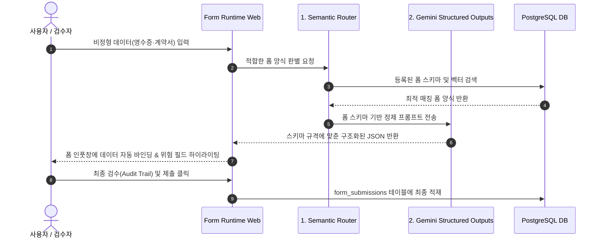

# AI Dynamic Form Builder & Runtime Engine

> **자연어 기반 동적 폼 스키마 빌더 및 비정형 데이터 정제 런타임 엔진**  
> FSD(Feature-Sliced Design) 아키텍처와 엔지니어링 하네스(Harness) 가드레일 기반 프로토타입

---

## 1. Executive Summary

사내 백오피스 및 B2B SaaS 환경에서 폼(Form) 관리 비용과 비정형 데이터 입력 공수는 가장 빈번한 생산성 병목 중 하나입니다. 또한 대형 언어 모델(LLM)을 업무 시스템에 도입할 때 발생하는 **환각(Hallucination), 비정형 출력 포맷 깨짐, 불필요한 토큰 비용 낭비**는 프로덕션 안착을 가로막는 주요 장애물입니다.

본 프로젝트는 이 문제를 해결하기 위해 두 가지 핵심 축으로 설계되었습니다:

1. **Form Builder Engine**: 자연어 프롬프트를 통해 정형화된 **JSON Schema / Zod 스키마**를 동적으로 생성하고 실시간 렌더링 및 커스텀을 지원
2. **Dynamic Runtime Parser**: 영수증, 계약서, 메모 등 비정형 텍스트·이미지를 입력받아 **Gemini Structured Outputs** 규격으로 파싱하고 폼 필드에 1:1 자동 바인딩(Human-in-the-loop 검수)

단순한 AI API 연동 토이 프로젝트를 넘어, **엄격한 FSD 경계 검증, TDD 테스트 하네스, UI/타입 가드레일**을 선제적으로 구축하여 엔터프라이즈 환경에 즉시 확장 가능한 아키텍처를 제시합니다.

---

## 2. Product & Feature Philosophy: 자율형 인터랙션과 결과 중심 설계

본 프로젝트가 제공하는 모든 기능은 **"자율주행 자동차의 미니멀 대시보드 철학"**을 기반으로 설계됩니다.

일반적인 엔터프라이즈 소프트웨어는 기능이 추가될수록 화면에 수많은 버튼, 복잡한 메뉴 트리, 세부 설정 패널을 증식시킵니다. 이로 인해 비즈니스 도메인 지식(업무 규칙, 데이터 요구사항)은 명확하지만 UI 조작법을 알지 못하는 현업 전문가는 극심한 인지적 피로를 겪게 됩니다.

자율주행 자동차가 복잡한 계기판과 수많은 물리 버튼을 과감히 없애고 단 하나의 정돈된 화면과 자율주행 시스템에 운전 조작을 온전히 위임한 것처럼, 본 프로젝트는 시스템 내의 모든 기능에서 **조작의 복잡성을 사용자에게 전가하지 않는 3대 핵심 철학**을 고수합니다.

### 1) 3대 핵심 기능 철학 (Core Functional Principles)

#### 1. Zero-Manipulation (조작의 최소화 & 마우스리스)

- 마우스 드래그 앤 드롭, 복잡한 설정 모달, 다단계 옵션 체크 등 불필요한 미세 조작을 화면에서 원천 배제합니다.
- 사용자는 도메인 전문 지식을 바탕으로 자연어 명령이나 비정형 데이터(업무 의도)만 단일 창구로 전달합니다.

#### 2. Autonomous Delegation (AI에게 온전한 위임)

- "화면을 어떻게 배치할 것인가", "필드와 타입을 어떻게 정의할 것인가", "검증 규칙과 파이프라인을 어떻게 엮을 것인가"와 같은 구현 세부사항은 AI 엔진이 온전히 전담합니다.
- '어떻게 구현할 것인가(How)'는 시스템이 해결하며, 사용자는 '무엇이 필요한가(What)'에만 집중합니다.

#### 3. Outcome-Driven Supervision (결과 중심의 감독관 모델)

- 사용자는 툴을 붙잡고 씨름하는 조작자가 아니라, 최종 의사결정을 내리는 **감독관(Supervisor)**입니다.
- 중간 설정 과정이나 복잡한 설정값을 보여주지 않고, 실제 동작하는 최종 결과물(Living Outcome)을 즉시 시각화하여 사용자가 결과를 직접 체험하고 승인(Approve)하거나 자연어로 피드백(Refine)하도록 지원합니다.

### 2) 패러다임 전환: 조작 중심에서 판단 중심으로

| 관점              | 기존 기능 설계 패러다임                   | 본 프로젝트의 자율형 설계 패러다임                 |
| :---------------- | :---------------------------------------- | :------------------------------------------------- |
| **사용자 경험**   | 툴의 사용법과 화면 구성을 학습해야 함     | 도메인 지식만 있으면 조작 학습 없이 즉시 사용      |
| **인터페이스**    | 기능이 늘어날수록 제어 패널과 버튼이 증식 | 단 하나의 정돈된 미니멀 뷰와 단일 의도 입력창 유지 |
| **작업 흐름**     | 수동 조작 -> 설정 튜닝 -> 결과 확인       | 의도 전달 -> 시스템 자율 조립 -> 결과 검토 및 판단 |
| **사용자의 위치** | 툴을 다루는 작업자(Operator)              | 최종 결과물을 승인하는 감독관(Supervisor)          |

---

## 3. System Architecture



---

## 4. Engineering Harness & Governance

본 저장소는 개발 생산성과 아키텍처 정합성을 기계적으로 통제하기 위한 **엔지니어링 하네스(Harness)** 가드레일을 준수합니다.

| 분류                   | 가드레일 도구                                                           | 통제 목적 및 효과                                                                                                         | 규칙 문서                                                                                                          |
| :--------------------- | :---------------------------------------------------------------------- | :------------------------------------------------------------------------------------------------------------------------ | :----------------------------------------------------------------------------------------------------------------- |
| **아키텍처 경계**      | `eslint-plugin-boundaries`                                              | FSD 레이어 간 단방향 의존성 강제, 세부 구현 직통 import 차단 및 Public API(`index.ts`) 강제                               | [.agents/rules/fsd-architecture-rule.md](.agents/rules/fsd-architecture-rule.md)                                   |
| **코딩 패러다임**      | ESLint `no-restricted-syntax`                                           | 함수형 지향, `class` 및 `this` 키워드 원천 차단, `{ data, error }` Result 패턴 준수                                       | [.agents/rules/coding-paradigm-rule.md](.agents/rules/coding-paradigm-rule.md)                                     |
| **파일 컨벤션**        | `eslint-plugin-check-file`                                              | 전역 `kebab-case` 파일/폴더 네이밍 강제 (OS 간 대소문자 경로 불일치 원천 차단)                                            | [.agents/rules/fsd-architecture-rule.md](.agents/rules/fsd-architecture-rule.md)                                   |
| **테스트 하네스**      | Vitest + React Testing Library                                          | ROI 중심 테스트 전략 (도메인 변환기 및 복합 인터랙션 중심 TDD 루프 확립)                                                  | [.agents/rules/testing-strategy-rule.md](.agents/rules/testing-strategy-rule.md)                                   |
| **UI 거버넌스**        | Tailwind CSS v4 + shadcn/ui                                             | `@/shared/ui` 최우선 재사용, 시맨틱 토큰(`bg-background`, `text-foreground`) 필수화                                       | [.agents/rules/ui-and-styling-rule.md](.agents/rules/ui-and-styling-rule.md)                                       |
| **스펙 거버넌스**      | Spec-Driven Dev + YAGNI                                                 | [`TEMPLATE.md`](docs/specs/TEMPLATE.md) 기반 Non-Goals 엄격 통제, 추측성 오버엔지니어링 차단 및 검증된 요구사항 중심 구현 | [규칙 문서](.agents/rules/spec-driven-development-rule.md) / [자동화 스킬](.agents/skills/spec-authoring/SKILL.md) |
| **커밋 거버넌스**      | Husky + lint-staged + Commitlint                                        | Conventional Commits 규격 강제, 빠른 커밋 리듬 유지를 위한 점진적 검증                                                    | [.agents/rules/git-commit-automation-rule.md](.agents/rules/git-commit-automation-rule.md)                         |
| **날짜/시간 거버넌스** | `date-fns` 래핑 + ESLint `no-restricted-imports` + Drizzle `sql`now()`` | "Store in UTC, Display in Local" 철칙 강제, 중앙 DB 시계 권한 확립, 서드파티 직접 import 원천 차단                        | [.agents/rules/date-and-time-rule.md](.agents/rules/date-and-time-rule.md)                                         |

### AI Agent Governance & Harness Documents

본 레포지토리는 AI 페어 프로그래밍 환경에서 코드 품질과 아키텍처 일관성을 기계적으로 유지하기 위해 정교한 에이전트 거버넌스 체계를 운용합니다. 아래 링크를 통해 각 분야별 표준 명세를 직접 열람할 수 있습니다.

- **상위 운영 헌장**: [`AGENTS.md`](AGENTS.md) (골든 룰, YAGNI, 올인원 검증 파이프라인)
- **아키텍처 & 설계 규격**:
  - [FSD 아키텍처 규칙](.agents/rules/fsd-architecture-rule.md) - 레이어 단방향 의존성 및 Public API 원칙
  - [코딩 패러다임 규칙](.agents/rules/coding-paradigm-rule.md) - 함수형 지향, Result 패턴, 경계선 Zod 검증, YAGNI
  - [UI & 스타일링 규칙](.agents/rules/ui-and-styling-rule.md) - shadcn/ui 재사용, Tailwind v4 시맨틱 토큰
  - [날짜 & 시간 처리 규칙](.agents/rules/date-and-time-rule.md) - "Store in UTC, Display in Local" 철칙 및 중앙 DB 시계 권한, 공통 유틸리티 래핑
- **프로세스 & 자동화 스킬**:
  - [스펙 주도 개발(SDD) 규칙](.agents/rules/spec-driven-development-rule.md) - 5단계 적응형 라이프사이클 및 브랜치 격리
  - [스펙 표준 템플릿](docs/specs/TEMPLATE.md) - 단일 진실 원천(SSOT) 마크다운 양식
  - [스펙 작성 자동화 스킬](.agents/skills/spec-authoring/SKILL.md) - 대화형 초안 생성 및 브랜치 분기 스킬
  - [ROI 중심 테스트 전략](.agents/rules/testing-strategy-rule.md) - 도메인 런타임 및 핵심 인터랙션 중심 TDD
  - [Git 커밋 자동화 규칙](.agents/rules/git-commit-automation-rule.md) - Conventional Commits 컨벤션

---

## 5. Architecture Layers (Feature-Sliced Design)

단방향 결합도와 관심사 분리를 보장하기 위해 **FSD(Feature-Sliced Design)** 레이어 원칙을 기반으로 모듈화됩니다:

```
src/
├── app/          # 진입점: Next.js App Router 라우팅, 전역 레이아웃 및 BFF 핸들러
├── widgets/      # 결합 블록: 독립적으로 완결된 대형 복합 UI 패널
├── features/     # 기능 단위: 사용자 인터랙션 및 유스케이스 로직 (폼 빌더, 런타임 검수기)
├── entities/     # 도메인 모델: 폼 스키마 규격 정의, 비즈니스 핵심 엔티티 및 스키마 변환기
└── shared/       # 공통 인프라: 재사용 UI 키트(shadcn/ui), SDK 클라이언트 및 유틸리티(HTTP, DB, Gemini)
```

- **Public API 거버넌스**: `entities`, `features`, `widgets` 레이어는 슬라이스 루트의 `index.ts`를 통해서만 외부 참조를 허용하며, 내부 세부 파일로의 직통 참조는 ESLint 단계에서 엄격히 차단됩니다.
- **UI 번들 최적화 (No Barrel)**: `shared/ui`는 번들 오염 방지 및 트리쉐이킹을 위해 배럴 파일을 두지 않고 개별 직접 임포트(`@/shared/ui/button`) 방식을 강제합니다.

---

## 6. Key Technical Decisions & Trade-offs

### 1. 단일 Next.js 레포지토리 (vs 모노레포)

- **결정**: Turborepo 등 모노레포 오버헤드를 배제하고, 단일 Next.js 앱 내 라우트 그룹 및 FSD 모듈화로 해결.
- **이유**: 빌드 파이프라인 구성 및 패키지 간 의존성 관리에 드는 인프라 공수를 아끼고, **동적 폼 렌더링 엔진과 AI 파이프라인 검증**이라는 핵심 문제에 집중.

### 2. Zod & Gemini Structured Outputs 기반 런타임 타입 방어

- **결정**: LLM 응답을 자유 텍스트가 아닌 `responseSchema`를 통한 JSON 형식으로 강제하고, 프론트엔드 유입 전 `zod.safeParse()` 검증.
- **이유**: AI의 환각(Hallucination)으로 인한 잘못된 데이터가 폼 상태(State)로 침투하는 것을 원천 차단.

### 3. 유사도 임계치(Threshold) 기반 방어적 RAG 라우팅

- **결정**: 모든 요청에 무분별하게 벡터 검색을 태우지 않고, 모호한 자연어/이미지 인입 시에만 `pgvector` 코사인 유사도 검색 가동.
- **이유**: 불필요한 임베딩 호출 비용을 줄이고, 1위 유사도가 기준치(0.75) 미만일 경우 Fallback UI로 유도하여 오작동 방지.

### 4. TDD 하네스 분리 (개발 실시간 vs 커밋 경량화)

- **결정**: 커밋 단계(`pre-commit`)에서는 `lint-staged`와 `typecheck`만 실행하여 빠른 커밋 리듬(~2초)을 보존하고, 테스트는 개발 시 `npm run test:watch`로 실시간 피드백 수행.
- **이유**: 테스트 스위트 증가 시 커밋 지연으로 인한 개발 생산성 저하 및 `--no-verify` 우회 습관 방지.

### 5. YAGNI 기반 점진적 설계 및 스코프 통제 (vs 조기 추상화 및 오버엔지니어링)

- **결정**: "나중에 쓸지도 모른다"는 막연한 추측성 코딩(불필요한 i18n 라이브러리 도입, 호출처 없는 유틸리티, 조기 플러그인 추상화)을 배제하고, `docs/specs/`의 Non-Goals를 통해 현재 검증된 핵심 요구사항만 집중 구현.
- **이유**: 주니어/초기 프로젝트에서 흔히 발생하는 오버엔지니어링(Over-engineering)과 불필요한 유지보수 부채를 원천 차단하고, 실제 사용자 인터랙션 검증 피드백에 맞춰 점진적·안정적으로 시스템을 고도화하기 위함.

### 6. 조작 배제 및 결과 중심 인터페이스 (vs 수동 설정 패널 증식)

- **결정**: 복잡한 드래그 앤 드롭 캔버스와 설정 모달 패널 대신, 단일 프롬프트 입력과 완성된 결과물의 실시간 렌더링 인터페이스 채택.
- **이유**: 도메인 전문가에게 불필요한 UI 학습 비용을 전가하지 않고, AI에게 조작을 온전히 위임하여 결과 검토 및 판단(Supervision)에만 집중하도록 보장.

### 7. 중앙 DB 시계 권한 및 UTC 단일 진실 원천 (vs 분산 환경 시계 오차)

- **결정**: DB 레코드 타임스탬프(`updatedAt`, `deletedAt`, `publishedAt`)는 Drizzle의 `sql`now()``를 사용하여 PostgreSQL 중앙 시계에 위임하고, 비-DB 계층(JSONB 직렬화 등)은 `@/shared/lib/utils`의 `nowUtcIso()`로 표준화. UI 표시 시점에만 브라우저 로컬 시간대로 변환("Store in UTC, Display in Local").
- **이유**: 분산 서버/컨테이너 환경에서 각 인스턴스 런타임의 `new Date()` 호출 시 발생할 수 있는 Clock Drift(시계 불일치) 및 타임존 오차를 원천 방지하고, ESLint `no-restricted-imports` 가드레일로 서드파티 라이브러리(`date-fns`) 직접 참조를 차단하여 날짜 연산 로직을 단일 진실 원천(SSOT)으로 캡슐화하기 위함.

---

## 7. Getting Started

### 1. Requirements

- Node.js 20.x 이상 (v24 권장)
- npm 10.x 이상

### 2. Environment Variables

프로젝트 루트에 `.env.local` 파일을 생성하고 필요한 키를 입력합니다:

```bash
cp .env.example .env.local
```

```env
DATABASE_URL=postgresql://postgres:[PASSWORD]@[HOST]:[PORT]/[DATABASE]
GEMINI_API_KEY=your_gemini_api_key_here
```

### 3. Available Scripts

| 명령어                  | 설명                                                               |
| :---------------------- | :----------------------------------------------------------------- |
| `npm run dev`           | Next.js 로컬 개발 서버 실행 (Turbopack)                            |
| `npm run build`         | 프로덕션 빌드 생성                                                 |
| `npm run start`         | 프로덕션 서버 실행                                                 |
| `npm run verify`        | [통합 검증] 타입 검사 + 린트 + 포맷 + 전체 테스트 완주 (결함 점검) |
| `npm run check`         | [정적 검사] 타입 검사 + 린트 + 포맷 일치 여부 검사                 |
| `npm run fix`           | [자동 교정] Prettier 코드 포맷팅 및 ESLint 자동 수정               |
| `npm test`              | Vitest 기반 전체 단위/컴포넌트 테스트 1회 실행                     |
| `npm run test:watch`    | 파일 변경 감지 실시간 TDD 루프 실행                                |
| `npm run test:coverage` | V8 엔진 기반 테스트 커버리지 리포트 생성                           |
| `npm run typecheck`     | TypeScript 전체 정적 타입 검사 (`tsc --noEmit`)                    |
| `npm run lint`          | ESLint (FSD 경계 및 네이밍 컨벤션 검사)                            |
| `npm run format`        | Prettier 코드 포맷팅 자동 수정                                     |
| `npm run format:check`  | Prettier 코드 스타일 일치 여부 검사                                |
