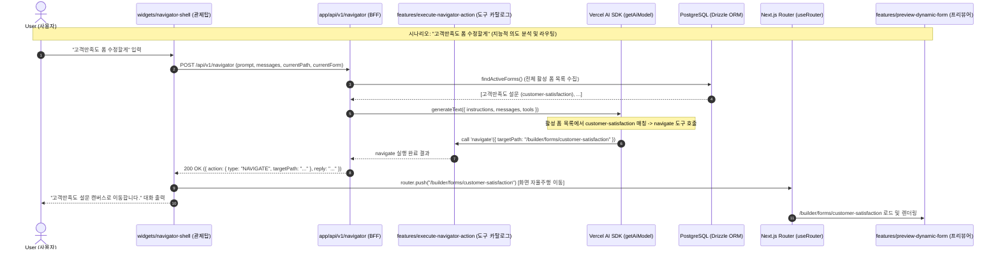

# [Spec-001] Autonomous AI Navigator & Core Form Previewer

> [!NOTE]
>
> - **상태 (Status)**: Active (구현 완료 및 검증 통과, 고도화 단계)
> - **브랜치 (Branch)**: `feat/spec-001-autonomous-navigator-core`
> - **작성일 (Created)**: 2026-11-07
> - **완료일 (Archived)**: -

---

## 1. 배경 및 문제 정의 (Context & Problem Statement)

기존 웹 폼 빌더는 수많은 메뉴를 클릭해 이동하고 마우스로 드래그 앤 드롭하며 필드를 일일이 타이핑/수정해야 하므로 사용자 피로도와 프론트엔드 UI 복잡도가 극도로 높습니다.

본 시스템은 **"테슬라의 자율주행 대시보드 철학"**을 웹 인터페이스에 도입합니다:

1. **제어 평면의 단일화 (Control Plane)**: 마우스를 통한 폼 항목 수동 직접 수정을 완전히 배제하고, 오직 상시 상주하는 **AI Navigator와의 자연어 대화**만을 시스템 조작의 단일 진입점으로 확립합니다.
2. **관측 평면의 시각화 (Observability Plane)**: 메인 화면은 수동 편집기가 아니라, AI Navigator가 생성/수정한 폼의 현재 상태(Digital Twin)를 실시간으로 보여주는 **순수 프리뷰어(Live Preview Canvas)**로 한정합니다.
3. **지능형 도구 카탈로그 기반 자율주행 (Autonomous Tool Calling)**: 정적인 텍스트 파싱 대신 AI 모델이 전체 시스템 상황(전체 폼 목록, 현재 화면 위치)과 이전 대화 맥락을 파악하고 전용 도구(Tool)를 직접 실행하도록 하여 높은 제어 정밀도를 달성합니다.

---

## 2. 목표 및 비목표 (Goals & Non-Goals)

- **Goals (1단계 MVP 핵심 목표)**:
  1. **Persistent Navigator Shell Layout**: 화면 좌/우측에 상시 상주하며 대화 및 자율주행 실행 상태를 조율하는 전역 워크스페이스 레이아웃 구현.
  2. **Core Component Registry**: 프로덕션 폼의 80% 이상을 차지하는 핵심 4종 필드(`text`, `textarea`, `number`, `select`)의 결정론적 렌더링 규격 구축.
  3. **Zero-Manual-Edit Live Preview Canvas**: 마우스 수정 도구가 전혀 없는, 순수 실시간 렌더링 전용 폼 프리뷰어 캔버스 구현.
  4. **Vercel AI SDK 공급자 중립적 도구 카탈로그 파이프라인**:
     - `navigate`: "폼 목록으로 가줘", "고객만족도 폼 열어줘" 등 라우팅 자율주행
     - `createForm`: "프로젝트 폼 생성해줘" -> DB 영속화 및 해당 캔버스 즉시 전환
     - `updateSchema`: "마감일 필드 추가해줘", "이메일 필드 삭제해줘" -> 프리뷰 화면 실시간 리렌더링
     - `deleteForm`: "고객만족도 폼 삭제해줘" -> 안전한 소프트 삭제 및 폼 목록 복귀
     - `listForms`: "등록된 폼 뭐 있어?" -> 현재 활성 폼 목록 대화 요약
  5. **입체적 시스템 맥락 (Full Context Awareness) & 대화 히스토리 (Multi-turn Context)**:
     - 현재 화면 URL, 현재 폼 스키마, DB 등록 전체 폼 목록을 주입하여 상황에 맞는 지능적 의도 분석.
     - 세션 내 대화 히스토리(`messages`)를 전달하여 되묻기(Clarification) 및 연속 티키타카 지원.
  6. **Top-Down Orchestration Architecture**: `features/execute-navigator-action`이 의도를 해석하여 이벤트를 위(`widgets/navigator-shell`)로 올리고, 상위 위젯이 하위 라우터 및 `entities/form` 스토어로 명령을 하향 전달하는 아키텍처 확립.

- **Non-Goals (차기 스펙으로 명확히 분리)**:
  - **Spec-002 이관 (고도화 및 텔레메트리)**:
    - 고급 필드군 (`date`, `rating`, `slider`, `checkbox`, `section_header`)
    - 정밀 텔레메트리 (Diff Highlight 펄스 애니메이션, Click-to-Mention, Undo 되돌리기)
    - 폼 최종 게시(`PUBLISH_FORM`) 및 공개 응답 제출 뷰
  - **Spec-003 이관 (분석 및 시각화)**:
    - 수집된 응답 데이터 기반 차트/애널리틱스 자율주행 빌더
  - **공통 배제**:
    - 마우스 드래그 앤 드롭 및 캔버스 인라인 텍스트 직접 타이핑 편집 기능 (시스템 철학상 의도적 원천 배제)
    - 음성 인식/합성 (STT/TTS)

---

## 3. 제안 솔루션 및 계약 (Proposed Solution & Contracts)

### 1) FSD 아키텍처 계층 배치

```text
src/
├── app/
│   ├── builder/                           # 빌더 작업공간
│   │   ├── layout.tsx                     # Persistent Shell(좌/우 분할) 전역 워크스페이스 레이아웃
│   │   ├── forms/[slug]/page.tsx          # 실시간 폼 프리뷰어 캔버스 페이지
│   │   ├── forms/page.tsx                 # 폼 목록 페이지
│   │   └── views/page.tsx                 # 뷰어 대시보드 페이지
│   ├── consumer/                          # 최종 사용자 폼 응답 작성 페이지
│   └── api/v1/navigator/                  # AI Navigator BFF 엔드포인트
│       ├── route.ts                       # Thin Route Handler (입력 검증 및 러너 위임)
│       └── route.test.ts                  # HTTP 계층 검증 테스트
├── widgets/
│   └── navigator-shell/                   # 상시 상주형 네비게이터 지휘자 (중앙 관제탑)
│       ├── ui/navigator-shell.tsx         # 채팅 패널 배치, 히스토리 동봉 및 라우팅 디스패치
│       ├── store/navigator-chat.store.ts  # 네비게이터 대화 내역 및 UI 패널 상태 (Zustand)
│       └── index.ts
├── features/
│   ├── execute-navigator-action/          # LLM 도구 카탈로그 및 액션 실행 파이프라인
│   │   ├── server/                        # 서버 전용 오케스트레이션 엔진
│   │   │   ├── navigator-runner.server.ts # 시스템 프롬프트, 맥락 합성, 도구 추론 실행
│   │   │   └── navigator-runner.server.test.ts # 엔진 비즈니스 단위 테스트
│   │   ├── server.ts                      # 서버 전용 Public API 엔트리포인트
│   │   ├── lib/navigator-tools.ts         # 5종 도구 카탈로그 (navigate, createForm, updateSchema, deleteForm, listForms)
│   │   ├── lib/action-parser.ts           # 액션 안전 파서
│   │   ├── types/action.types.ts          # 액션 Zod 스키마, 대화 히스토리 및 Result 타입
│   │   ├── queries/use-navigator.mutation.ts # 액션 실행 및 React Query 뮤테이션 훅
│   │   └── index.ts
│   └── preview-dynamic-form/              # 마우스 편집이 없는 순수 폼 프리뷰어
│       ├── ui/form-preview-canvas.tsx     # 폼 프리뷰 캔버스 컴포넌트
│       ├── ui/field-registry.tsx          # text, textarea, number, select 4종 매핑
│       ├── ui/form-field-wrapper.tsx      # 라벨, 필수 표시(*), 설명 문구 공통 래퍼
│       └── index.ts
├── entities/
│   └── form/                              # 폼 비즈니스 도메인 모델 및 서버 상태
│       ├── schema/form.schema.ts          # 기존 forms 테이블 및 Drizzle/Zod 스키마
│       ├── types/form-field.types.ts      # 4종 코어 필드 및 활성 폼 규격
│       ├── queries/use-form-detail.query.ts # TanStack Query 단건 폼 조회 훅 (단일 진실 원천)
│       ├── queries/use-forms.query.ts     # 활성 폼 목록 조회 훅
│       ├── queries/use-form.mutation.ts   # 폼 생성/수정/삭제 뮤테이션 훅
│       ├── queries/form.keys.ts           # 쿼리 키 팩토리
│       ├── server/form.server.ts          # 폼 DB 영속화 서버 로직 (findActiveForms, softDeleteFormById 등)
│       └── index.ts
└── shared/
    ├── lib/ai/                            # 공급자 중립적 AI 모델 추상화 (getAiModel)
    └── ui/                                # 순수 UI 원자 컴포넌트 키트 (shadcn/ui 기반)
```

### 2) 데이터 및 이벤트 흐름 (Tool Calling Orchestration)

시스템은 **"전체 맥락 주입(Context Injection) -> 도구 실행(Tool Execution) -> 이벤트 상위 보고(Events Up) -> 브라우저 제어(Data Down)"** 파이프라인으로 동작합니다.



### 3) 데이터 계약 (Core Field, Action & Tool Schemas)

#### 핵심 4종 필드 규격

```typescript
export const coreFormFieldSchema = z.object({
  id: z.string().describe("필드 고유 식별자"),
  name: z.string().describe("데이터 저장용 키값"),
  label: z.string().describe("화면에 표시되는 필드 라벨"),
  type: z.enum(["text", "textarea", "number", "select"]).describe("1단계 지원 필드 4종"),
  placeholder: z.string().optional(),
  required: z.boolean().default(false),
  options: z.array(z.string()).optional().describe("select 타입 선택 항목 목록"),
  description: z.string().optional().describe("하단 안내 설명 문구"),
});
```

#### 도구 카탈로그(Tool Catalog) 5종 규격

1. `navigate`: 화면 경로 전환 (`/builder/forms`, `/builder/views`, `/consumer`, `/builder/forms/[slug]`)
2. `listForms`: 활성 폼 목록 조회 및 요약
3. `createForm`: 신규 폼 DB 저장 및 캔버스 초기화
4. `updateSchema`: 필드 추가(`ADD_FIELD`), 필드 삭제(`REMOVE_FIELD`), 필드 수정(`MODIFY_FIELD`), 폼 제목/설명 변경(`UPDATE_INFO`)
5. `deleteForm`: 폼 소프트 삭제(`softDeleteFormById`) 및 폼 목록 복귀

#### 대화 히스토리 및 요청 페이로드 규격

```typescript
export interface ChatHistoryMessage {
  role: "user" | "assistant";
  content: string;
}

export interface ExecuteNavigatorActionPayload {
  prompt: string;
  messages?: ChatHistoryMessage[] | undefined;
  currentContext?:
    | {
        currentPath?: string | undefined;
        currentForm?:
          | {
              slug: string;
              title: string;
              description?: string | undefined;
              fields: CoreFormField[];
            }
          | undefined;
      }
    | undefined;
}
```

---

## 4. 고려한 대안 및 기각 사유 (Alternatives Considered)

- **대안 A: 전역 `shared/store`에 모든 상태 배치**
  - 기각 사유: 비즈니스 도메인 지식이 최하위 레이어로 누수되어 FSD 단방향 의존성을 훼손함. 오케스트레이션은 `widgets`, 도메인 데이터는 `entities`로 분리 배치하는 상위 조립 패턴을 채택함.
- **대안 B: 마우스 수동 편집과 AI 편집 동시 지원 (하이브리드)**
  - 기각 사유: 상태 동기화 충돌과 캔버스 코드 비대화 발생. 테슬라 대시보드 철학에 따라 마우스 수동 편집을 완전히 배제하고 순수 프리뷰어와 대화형 단일 제어로 단순화함.
- **대안 C: 텍스트 파싱 기반 액션 추출 (초기 설계)**
  - 기각 사유: 자연어 발화에서 폼 의도, 이동 경로, 필드 변경 매개변수를 LLM이 직접 도구로 호출하는 Tool Calling 방식이 훨씬 정밀하고 환각(Hallucination)이 적음.

---

## 5. 마일스톤 및 검증 결과 (Milestones & Verification)

1. [x] **Step 1: Domain & Query Pipeline (TDD)**
   - `entities/form/types/form-field.types.ts`: 코어 4종 필드 Zod 스키마 정의
   - `entities/form/server/form.server.ts`: `findActiveForms`, `findFormBySlug`, `insertForm`, `updateFormById`, `softDeleteFormById` 구현 및 단위 테스트
   - `entities/form/queries/`: 단건 조회, 목록 조회, 생성/수정/삭제 쿼리/뮤테이션 훅 구현 및 테스트
   - `entities/form/server.ts` & `index.ts`: Next.js 16 App Router `server-only` 경계 분리
2. [x] **Step 2: Preview Foundation (TDD)**
   - `features/preview-dynamic-form/ui/form-field-wrapper.tsx`: 라벨, 필수(*) 표식, 설명 공통 래퍼
   - `features/preview-dynamic-form/ui/field-registry.tsx`: 코어 4종 필드(`text`, `textarea`, `number`, `select`) 매핑
   - `features/preview-dynamic-form/ui/form-preview-canvas.tsx`: 실시간 순수 프리뷰 캔버스 구현 및 컴포넌트 테스트 7건 통과
3. [x] **Step 3: Tool Catalog & AI Model Abstraction (TDD)**
   - `shared/lib/ai/model.ts`: Vercel AI SDK 기반 공급자 중립적 AI 모델 계층(`getAiModel`) 구축 및 테스트 3건 통과
   - `features/execute-navigator-action/lib/navigator-tools.ts`: 5종 도구 카탈로그 구현 및 단위 테스트 7건 통과
   - `features/execute-navigator-action/server/`: AI 오케스트레이션 엔진(`navigator-runner.server.ts`) 분리 및 BFF Thin Route 핸들러 구현 (테스트 8건 통과)
   - `features/execute-navigator-action/queries/use-navigator.mutation.ts`: React Query 뮤테이션 훅 구현 및 테스트 3건 통과
4. [x] **Step 4: Navigator Shell Widget & Layout Integration (TDD)**
   - `widgets/navigator-shell/store/navigator-chat.store.ts`: Zustand 대화 UI 스토어 구현 및 테스트 5건 통과
   - `widgets/navigator-shell/ui/navigator-shell.tsx`: 대화 히스토리(`messages`) 동봉 및 라우팅/오케스트레이션 패널 구현 및 테스트 5건 통과
   - `src/app/builder/layout.tsx`: 상주 패널 지속형 분할 레이아웃 조립 (네비게이션 탭 포함)
   - `src/app/builder/forms/[slug]/page.tsx`: 실시간 캔버스 라우팅 페이지 연동
   - `src/app/page.tsx`: 루트 게이트웨이 정돈 (빌더 vs 컨슈머)
5. [x] **Step 5: End-to-End Verification**
   - `npm run verify` (tsc, eslint, prettier, vitest) **24개 파일 108개 테스트 결함 0건 완주**
   - `npm run build` Next.js 16.4.4 Turbopack 프로덕션 빌드 성공 확인
