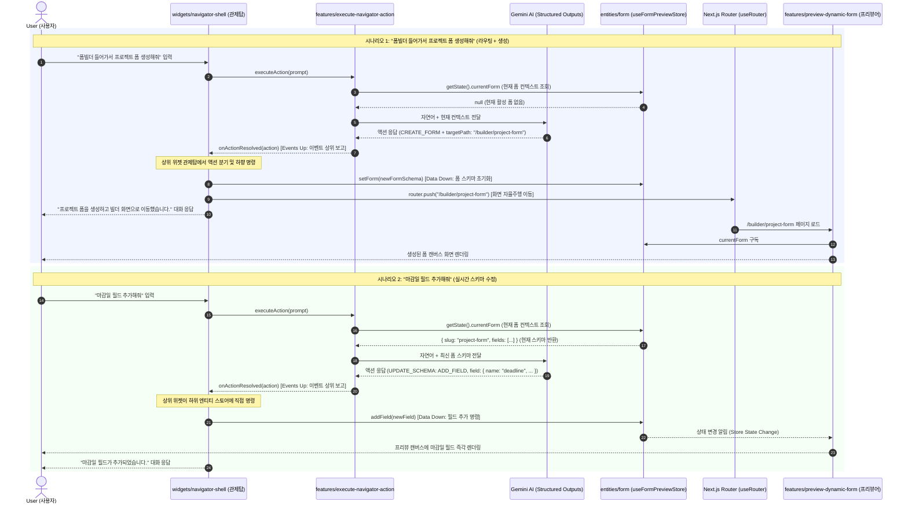

# [Spec-001] Autonomous AI Navigator & Core Form Previewer

> [!NOTE]
>
> - **상태 (Status)**: Active (구현 진행 예정)
> - **브랜치 (Branch)**: `feat/spec-001-autonomous-navigator-core`
> - **작성일 (Created)**: 2026-11-07
> - **완료일 (Archived)**: -

---

## 1. 배경 및 문제 정의 (Context & Problem Statement)

기존 웹 폼 빌더는 수많은 메뉴를 클릭해 이동하고 마우스로 드래그 앤 드롭하며 필드를 일일이 타이핑/수정해야 하므로 사용자 피로도와 프론트엔드 UI 복잡도가 극도로 높습니다.

본 시스템은 **"테슬라의 자율주행 대시보드 철학"**을 웹 인터페이스에 도입합니다:

1. **제어 평면의 단일화 (Control Plane)**: 마우스를 통한 폼 항목 수동 직접 수정을 완전히 배제하고, 오직 상시 상주하는 **AI Navigator와의 자연어 대화**만을 시스템 조작의 단일 진입점으로 확립합니다.
2. **관측 평면의 시각화 (Observability Plane)**: 메인 화면은 수동 편집기가 아니라, AI Navigator가 생성/수정한 폼의 현재 상태(Digital Twin)를 실시간으로 보여주는 **순수 프리뷰어(Live Preview Canvas)**로 한정합니다.

---

## 2. 목표 및 비목표 (Goals & Non-Goals)

- **Goals (1단계 MVP 핵심 목표)**:
  1. **Persistent Navigator Shell Layout**: 화면 좌/우측에 상시 상주하며 대화 및 자율주행 실행 상태를 조율하는 전역 워크스페이스 레이아웃 구현.
  2. **Core Component Registry**: 프로덕션 폼의 80% 이상을 차지하는 핵심 4종 필드(`text`, `textarea`, `number`, `select`)의 결정론적 렌더링 규격 구축.
  3. **Zero-Manual-Edit Live Preview Canvas**: 마우스 수정 도구가 전혀 없는, 순수 실시간 렌더링 전용 폼 프리뷰어 캔버스 구현.
  4. **Core Autonomous Action Pipeline**: 자연어를 해석하여 프론트엔드 화면을 조작하는 단방향 액션 파이프라인 완성:
     - **`NAVIGATE`**: "폼빌더 들어가줘", "폼 목록으로 이동해줘" 등 라우팅 자율주행
     - **`CREATE_FORM`**: "프로젝트 폼 생성해줘" -> 신규 폼 스키마 초기화 및 `/builder/[slug]` 화면으로 즉시 전환
     - **`UPDATE_SCHEMA`**: "마감일 필드 추가해줘", "설명 필드를 필수 입력으로 바꿔줘" -> 프리뷰 화면 실시간 리렌더링
  5. **Top-Down Orchestration Architecture**: `features/execute-navigator-action`이 의도를 해석하여 이벤트를 위(`widgets/navigator-shell`)로 올리고, 상위 위젯이 하위 라우터 및 `entities/form` 스토어로 명령을 하향 전달하는 아키텍처 확립.

- **Non-Goals (차기 스펙으로 명확히 분리)**:
  - **Spec-002 이관 (고도화 및 텔레메트리)**:
    - 고급 필드군 (`date`, `rating`, `slider`, `checkbox`, `section_header`)
    - 정밀 텔레메트리 (Diff Highlight 펄스 애니메이션, Click-to-Mention, Undo 되돌리기)
    - 폼 최종 게시(`PUBLISH_FORM`) 및 공개 응답 제출 뷰
  - **Spec-003 이관 (분석 및 시각화)**:
    - 수집된 응답 데이터 기반 차트/애널리틱스 자율주행 빌더
  - **공통 배제**:
    - 마우스 드래그 앤 드롭 및 캔버스 인라인 텍스트 직접 타이핑 편집 기능 (시스템 철학상 의도적 원천 배제)
    - 음성 인식/합성 (STT/TTS)

---

## 3. 제안 솔루션 및 계약 (Proposed Solution & Contracts)

### 1) FSD 아키텍처 계층 배치

```text
src/
├── app/
│   ├── (workspace)/
│   │   ├── layout.tsx                     # Persistent Shell(좌/우 분할) 전역 워크스페이스 레이아웃
│   │   ├── builder/[slug]/page.tsx        # 순수 폼 프리뷰어 캔버스 페이지
│   │   └── forms/page.tsx                 # 폼 목록 페이지
├── widgets/
│   └── navigator-shell/                   # 상시 상주형 네비게이터 지휘자 (중앙 관제탑)
│       ├── ui/navigator-shell.tsx         # 채팅 패널 배치 및 라우팅/스토어 하향 명령 디스패처
│       ├── store/navigator-chat.store.ts  # 네비게이터 대화 내역 및 UI 패널 상태 (위젯 스코프)
│       └── index.ts
├── features/
│   ├── execute-navigator-action/          # LLM 의도 해석 및 액션 이벤트 도출 기능
│   │   ├── lib/action-parser.ts           # Gemini 기반 자연어 파서
│   │   ├── types/action.types.ts          # 액션 Zod 스키마 및 Result 타입
│   │   ├── queries/use-navigator.mutation.ts # 액션 실행 및 컨텍스트 연동 뮤테이션
│   │   └── index.ts
│   └── preview-dynamic-form/              # 순수 폼 프리뷰어 (entities/form 스토어 구독)
│       ├── ui/form-preview-canvas.tsx     # 폼 프리뷰 캔버스 컴포넌트
│       ├── ui/field-registry.tsx          # text, textarea, number, select 4종 매핑
│       ├── ui/form-field-wrapper.tsx      # 라벨, 필수 표시(*), 설명 문구 공통 래퍼
│       └── index.ts
├── entities/
│   └── form/                              # 폼 비즈니스 도메인 모델 및 상태
│       ├── schema/form.schema.ts          # 기존 forms 테이블 및 Zod 스키마
│       ├── store/form-preview.store.ts    # 현재 프리뷰 중인 활성 폼 스키마 상태 (엔티티 스코프)
│       ├── server/form.server.ts          # 폼 DB 영속화 서버 로직
│       └── index.ts
└── shared/
    └── ui/                                # 순수 UI 원자 컴포넌트 키트 (shadcn/ui 기반)
```

### 2) 데이터 및 이벤트 흐름 (Top-Down Orchestration)

시스템은 **"데이터는 아래로(Data Down), 이벤트는 위로(Events Up)"** 원칙에 따라 동작합니다.



#### 흐름 세부 설명

1. **컨텍스트 인입 (Context Feedback)**:
   - 사용자가 메시지를 전송하면 `features/execute-navigator-action`이 `entities/form`의 현재 폼 스냅샷을 읽어와 AI에게 사용자 발화와 함께 주입합니다.
2. **이벤트 상위 보고 (Events Up)**:
   - 피처는 라우터를 직접 제어하지 않고, 파싱된 액션(`NAVIGATE`, `CREATE_FORM`, `UPDATE_SCHEMA`)을 상위 `widgets/navigator-shell`로 `onAction(action)` 콜백을 통해 전달합니다.
3. **명령 하향 디스패치 (Data Down)**:
   - 상위 위젯이 관제탑 역할을 수행하여:
     - `NAVIGATE` -> Next.js `router.push(targetPath)` 실행
     - `CREATE_FORM` -> `entities/form` 스토어에 폼 초기화 및 `/builder/[slug]` 이동
     - `UPDATE_SCHEMA` -> `entities/form` 스토어에 필드 추가/수정/삭제 함수 직접 호출
4. **결정론적 리렌더링 (Live Preview)**:
   - `features/preview-dynamic-form`은 엔티티 스토어의 변경을 감지하여 프리뷰 캔버스를 즉각 리렌더링합니다.

### 3) 데이터 계약 (Core Field & Action Schema)

```typescript
import { z } from "zod";

/**
 * 1단계 핵심 4종 폼 필드 스키마 정의
 */
export const coreFormFieldSchema = z.object({
  id: z.string().describe("필드 고유 식별자 (예: field_project_name)"),
  name: z.string().describe("데이터 저장용 키값"),
  label: z.string().describe("화면에 표시되는 필드 라벨"),
  type: z.enum(["text", "textarea", "number", "select"]).describe("1단계 지원 필드 4종"),
  placeholder: z.string().optional(),
  required: z.boolean().default(false),
  options: z.array(z.string()).optional().describe("select 타입일 때 선택 항목 목록"),
  description: z.string().optional().describe("하단 안내 설명 문구"),
});

export type CoreFormField = z.infer<typeof coreFormFieldSchema>;

/**
 * AI Navigator 1단계 핵심 액션 유니온
 */
export const navigatorActionSchema = z.discriminatedUnion("type", [
  /**
   * 화면 라우팅 이동 액션
   */
  z.object({
    type: z.literal("NAVIGATE"),
    targetPath: z.string().describe("이동할 경로 (예: /builder/project-info, /forms)"),
    message: z.string().describe("이동 안내 메시지"),
  }),

  /**
   * 신규 폼 생성 및 프리뷰 전환 액션
   */
  z.object({
    type: z.literal("CREATE_FORM"),
    slug: z.string().regex(/^[a-z0-9-]+$/),
    title: z.string(),
    description: z.string().optional(),
    fields: z.array(coreFormFieldSchema),
    message: z.string().describe("생성 완료 메시지"),
  }),

  /**
   * 폼 스키마 실시간 갱신 액션 (프리뷰 화면 즉시 반영)
   */
  z.object({
    type: z.literal("UPDATE_SCHEMA"),
    formSlug: z.string(),
    operation: z.enum(["ADD_FIELD", "REMOVE_FIELD", "MODIFY_FIELD"]),
    targetFieldId: z.string().optional().describe("수정/삭제 대상 필드 ID"),
    fieldData: coreFormFieldSchema.partial().optional(),
    message: z.string().describe("수정 안내 메시지"),
  }),
]);

export type NavigatorAction = z.infer<typeof navigatorActionSchema>;
```

### 4) 오류 처리 규격 (Result 패턴)

`features/execute-navigator-action/types/action.types.ts` 내에 캡슐화:

```typescript
export type ActionResult<T> =
  | { data: T; error: null }
  | { data: null; error: { code: string; message: string; details?: unknown } };
```

- 파싱 오류 발생 시 예외를 던지지 않고 `{ data: null, error: {...} }`를 반환하여 대화창에 사용자 친화적 안내를 렌더링하고 직전 폼 상태를 안전하게 보존합니다.

---

## 4. 고려한 대안 및 기각 사유 (Alternatives Considered)

- **대안 A: 전역 `shared/store`에 모든 상태 배치**
  - 기각 사유: 비즈니스 도메인 지식이 최하위 레이어로 누수되어 FSD 단방향 의존성을 훼손함. 오케스트레이션은 `widgets`, 도메인 데이터는 `entities`로 분리 배치하는 상위 조립 패턴을 채택함.
- **대안 B: 마우스 수동 편집과 AI 편집 동시 지원 (하이브리드)**
  - 기각 사유: 상태 동기화 충돌과 캔버스 코드 비대화 발생. 테슬라 대시보드 철학에 따라 마우스 수동 편집을 완전히 배제하고 순수 프리뷰어와 대화형 단일 제어로 단순화함.
- **대안 C: 10종 필드 및 텔레메트리/게시 기능 일괄 구현**
  - 기각 사유: 첫 구현 단위가 지나치게 거대해짐. 핵심 4종 필드로 "자연어 기반 자율주행 루프"를 먼저 완벽히 검증하는 것이 훨씬 안전하고 민첩함.

---

## 5. 리스크 및 제약 사항 (Risks & Open Questions)

- **Next.js App Router 레이아웃 유지**: 네비게이터 대화 패널과 메인 프리뷰 영역 간 페이지 이동 시 대화 내용(History)이 날아가지 않도록 `(workspace)/layout.tsx` 구조에서 위젯을 영속화해야 함.
- **LLM 추론 레이턴시**: 모델이 폼 스키마를 생성하는 동안 네비게이터 대화창과 프리뷰 캔버스에 즉각적인 피드백(작업 중 인디케이터)을 제공해야 함.

---

## 6. 마일스톤 및 검증 계획 (Milestones & Verification)

1. **Step 1: Domain & Preview Foundation (TDD)**
   - `entities/form/store/form-preview.store.ts` 구현 및 단위 테스트
   - `features/preview-dynamic-form/` 코어 4종 필드 렌더러 및 캔버스 UI 구현 및 컴포넌트 테스트
2. **Step 2: Action Engine & Parser (TDD)**
   - `features/execute-navigator-action/lib/action-parser.ts` Gemini 연동 파서 및 단위 테스트
   - `features/execute-navigator-action/` 뮤테이션 훅 구현
3. **Step 3: Navigator Shell Widget & Layout Integration**
   - `widgets/navigator-shell/` 대화 패널, 스토어 및 하향 디스패치 오케스트레이션 구현
   - `src/app/(workspace)/layout.tsx` 지속형 분할 레이아웃 배치
4. **Step 4: End-to-End Verification**
   - 자연어 지시를 통한 라우팅 -> 폼 생성 -> 실시간 필드 수정 완주 검증
   - `npm test` 단위/컴포넌트 테스트 100% 통과
   - `npm run verify` (타입체크, 린트, 포맷) 무결점 완주
