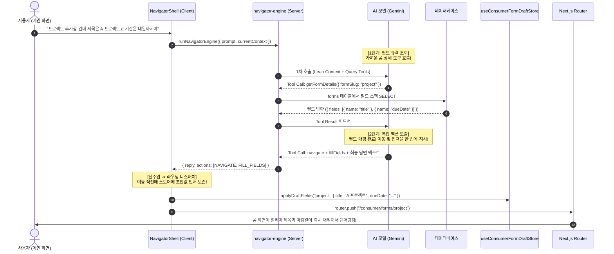

# [Spec-003] On-Demand Data Fetching & Multi-Step AI Navigator Engine

> [!NOTE]
>
> - **상태 (Status)**: Active (기획/검토 완료, 구현 착수)
> - **브랜치 (Branch)**: `feat/spec-003-on-demand-navigator-engine`
> - **작성일 (Created)**: 2026-11-09
> - **완료일 (Archived)**: -

---

## 1. 배경 및 문제 정의 (Context & Problem Statement)

기존 네비게이터 엔진(`Spec-001`, `Spec-002`)은 사용자가 발화를 입력할 때마다 서버가 빌더와 컨슈머 모드 구분 없이 등록된 모든 폼 목록(`findActiveForms`, `findPublishedForms`)과 무거운 필드 스키마 전체를 일괄 조회하여 프롬프트 텍스트에 강제로 밀어 넣는 **사전 전량 주입(Eager Pre-injection)** 방식을 사용하고 있습니다.

이 방식은 다음과 같은 확장성 및 운영적 한계를 가집니다:

1. **무거운 스키마 전량 주입으로 인한 토큰 낭비 및 환각**:
   - 폼과 필드가 늘어날수록 수만 토큰이 소모되며, 현재 사용자의 의도와 무관한 수많은 스키마가 모델의 주의력을 분산시켜 판단 오류를 유발합니다.
2. **화면 렌더링 데이터(React Query Cache)와의 단절**:
   - 사용자가 빌더 폼 목록(`/builder/forms`)이나 컨슈머 응답 목록(`/submissions`)을 보면서 _"두 번째 거 열어줘"_ 또는 *"홍길동 거 수정할래"*라고 말했을 때, 화면에 이미 렌더링된 캐시 데이터를 에이전트가 알지 못해 불필요한 DB 재조회가 발생하거나 정확한 대상을 매칭하지 못합니다.
3. **단발성 추론의 한계 (원샷 복합 명령 불가)**:
   - `maxSteps: 1` 수준의 단발 호출로는 메인 화면에서 *"프로젝트 추가할 건데 제목은 A고 기간은 내일까지야"*와 같이 **'폼 스펙 조회 -> 대상 화면 이동 -> 필드 값 자동 입력'**으로 이어지는 복합 작업을 한 턴에 연속적으로 해결할 수 없습니다.

따라서 빌더와 컨슈머 양쪽 모두에서 사전 전량 주입을 걷어내고, **"화면에 이미 보이는 데이터(React Query Cache)는 즉시 활용하고, 화면에 없는 대상은 가벼운 정보(ID, 제목) 위주로 선별 검색한 뒤 정밀 조회하여 연쇄 조작하는"** 지능형 **Multi-step Agentic Loop** 아키텍처로의 전환이 필요합니다.

---

## 2. 목표 및 비목표 (Goals & Non-Goals)

### Goals

1. **사전 전량 주입 제거 및 초경량 프롬프트(Lean Context) 전환 (빌더/컨슈머 공통)**:
   - 매 호출마다 전체 폼 목록 텍스트를 생성하던 서버 로직(`findActiveForms`, `findPublishedForms`)을 전면 제거하고, 현재 화면 경로 및 현재 열린 폼의 기본 메타데이터만 전달.
2. **화면 렌더링 데이터(React Query Cache) 시야 제공 (In-View Fast Path)**:
   - 빌더 폼 목록 화면: 화면에 렌더링된 캐시 목록(`visibleForms`)을 에이전트에 공급 (_"두 번째 폼 삭제해줘"_ 등 즉시 처리).
   - 컨슈머 응답 목록 화면: 화면 테이블에 렌더링된 캐시 목록(`visibleSubmissions`)을 공급 (_"두 번째 응답 열어줘"_ 등 즉시 처리).
3. **가벼운 식별 정보 중심의 단계적 폼 조회 도구(Query Tools) 2종 신설**:
   - `searchForms({ keyword, mode })`: 무거운 스키마 없이 `id, slug, title, description` 중심의 가벼운 메타데이터 선별 검색.
   - `getFormDetails({ formSlug })`: 원샷 명령 시 필드명을 매핑하기 위한 대상 폼 1개의 필드 스펙 정밀 조회.
4. **다단계 오케스트레이션 루프(`maxSteps: 5`) 구현**:
   - Vercel AI SDK `generateText`의 `maxSteps`를 활성화하여 `도구로 팩트 확인 -> 후속 판단 -> 기존 액션(이동/입력/수정) 실행`을 단일 요청 내에서 자율 완주.
5. **원샷 복합 명령을 위한 복합 액션 배열(`actions: NavigatorAction[]`) 및 스토어 선주입 보존**:
   - 에이전트가 단일 액션뿐만 아니라 연속적인 액션 파이프라인(`[NAVIGATE, FILL_FIELDS]`)을 한 번에 반환할 수 있도록 확장.
   - 화면 이동 직전 `useConsumerFormDraftStore`에 초안값을 먼저 안전하게 적재(선주입)하고 `router.push`하여, 이동된 폼 화면이 열리자마자 인풋 필드에 값이 즉시 채워지도록 보장.

### Non-Goals

- **기존 화면 조작 액션 도구 재작성 배제**: 이미 검증된 `fillFields`, `submitForm`, `createForm`, `updateSchema`, `deleteForms`, `navigate` 등 기존 액션 도구의 내부 로직은 그대로 재사용하며 재작성하지 않음.
- **불필요한 응답 본문 도구 조회 배제**: 과거 응답 데이터는 수정 화면 컴포넌트(`ConsumerSubmissionEditor`)가 자체 마운트하므로, 에이전트가 응답 본문을 직접 읽어오는 중복 도구(`getLatestSubmission` 등)는 작성하지 않음 (YAGNI 준수).
- **페이징 및 검색필터 URL 조작 확정 유보**: UI 상의 페이징 쿼리스트링 규격이 확정되기 전까지 페이징 전용 액션은 임의로 단정하지 않고 향후 스펙으로 보류.
- **자유 형식 Text-to-SQL 도입 금지**: 에이전트에게 임의의 SQL 생성 권한을 부여하지 않고, 오직 사전 정의된 안전한 API 도구만 호출하도록 제한.

---

## 3. 제안 솔루션 및 계약 (Proposed Solution & Contracts)

### 1) FSD 아키텍처 계층 배치

```text
src/
├── entities/
│   └── form-submission/
│       └── store/
│           ├── consumer-form-draft.store.ts   # [보강] 라우팅 슬러그 전환 시 선주입 초안값 보존 로직
│           └── consumer-form-draft.store.test.ts
├── features/
│   └── execute-navigator-action/
│       ├── lib/
│       │   ├── tools/
│       │   │   ├── query-tools.ts             # [신설] searchForms, getFormDetails (공통 execute 핸들러 장착)
│       │   │   └── query-tools.test.ts
│       │   └── prompts/
│       │       ├── builder-prompt.ts          # [경량화] activeForms 전량 주입 제거, visibleForms 반영
│       │       └── consumer-prompt.ts         # [경량화] publishedForms 전량 주입 제거, visibleSubmissions 반영
│       ├── server/
│       │   ├── navigator-engine.server.ts     # [강화] maxSteps: 5 다단계 오케스트레이션 및 복합 액션(actions[]) 수집
│       │   └── navigator-engine.server.test.ts # [추가] 다단계 연쇄 도구 및 원샷 복합 명령 시나리오 검증
│       └── types/
│           └── navigator-action.types.ts      # [확장] actions: NavigatorAction[], visibleForms, visibleSubmissions
└── widgets/
    └── navigator-shell/
        └── ui/
            ├── navigator-shell.tsx            # [보강] React Query 캐시 바인딩 및 복합 액션 순차 디스패치
            └── navigator-shell.test.tsx
```

---

### 2) 데이터 계약 (Schema & Interfaces)

#### `NavigatorClientContext` 및 복합 액션 인터페이스 (`navigator-action.types.ts`)

```typescript
export interface VisibleItemSummary {
  id: string;
  title: string;
  slug?: string;
  createdAt?: string;
  summary?: string;
}

export interface NavigatorClientContext {
  currentPath?: string;
  // Builder Context
  currentForm?: {
    slug: string;
    title: string;
    description?: string;
    fields: Array<Record<string, unknown>>;
  };
  visibleForms?: VisibleItemSummary[]; // [신규] 빌더 폼 목록 테이블의 렌더링 캐시

  // Consumer Context
  currentFormSlug?: string;
  currentFormTitle?: string;
  availableFields?: Array<{
    id?: string;
    name: string;
    label: string;
    type: string;
    required?: boolean;
    options?: string[];
  }>;
  currentDraftValues?: Record<string, unknown>;
  visibleSubmissions?: VisibleItemSummary[]; // [신규] 컨슈머 응답 목록 테이블의 렌더링 캐시
}

export interface NavigatorExecutionResponse {
  reply: string;
  message: string;
  action?: NavigatorAction | null; // 하위 호환
  actions?: NavigatorAction[]; // [신규] 연속 실행할 복합 액션 배열 (예: [NAVIGATE, FILL_FIELDS])
}
```

---

### 3) 신규 조회 도구(Query Tools) 인터페이스 계약 (`query-tools.ts`)

```typescript
// 1. 가벼운 식별 메타데이터 중심의 폼 선별 검색 도구
export const searchFormsTool = tool({
  description:
    "등록된 폼 목록을 키워드로 검색하여 폼 제목, 슬러그, 기본 설명 등의 가벼운 식별 메타데이터를 반환합니다.",
  parameters: z.object({
    keyword: z
      .string()
      .optional()
      .describe("검색할 폼 제목이나 설명 키워드 (생략 시 최신 폼 목록의 식별 정보 반환)"),
  }),
  execute: async ({ keyword }) => {
    // 무거운 필드 스키마 없이 상위 5개의 [{ id, slug, title, description }] 배열만 반환
  },
});

// 2. 타깃 폼 1개의 상세 필드 스펙 정밀 조회 도구
export const getFormDetailsTool = tool({
  description:
    "특정 폼의 전체 필드 스펙(라벨, name, 타입, 필수 여부, 선택지)을 정밀 조회합니다. 필드 값을 매핑하거나 스키마를 확인할 때 호출합니다.",
  parameters: z.object({
    formSlug: z.string().describe("필드 스펙을 조회할 대상 폼의 슬러그"),
  }),
  execute: async ({ formSlug }) => {
    // 대상 폼 1개의 필드 스키마 배열 반환
  },
});
```

---

### 4) 시스템 프롬프트 의도 판단 분기 규칙 (In-View vs Out-of-View)

```text
[지능적 의도 판단 및 도구 호출 분기 규칙]

1. 상황 A: 현재 화면에 있는 대상 조작 (화면 우선 / In-View Mode)
   - 조건: 사용자가 현재 화면에 눈으로 보이는 대상(목록의 N번째 행, 특정 이름, 현재 열린 폼의 필드 등)을 지칭할 때
   - 행동: 서버 조회 도구를 일체 호출하지 않고, 화면 맥락(visibleForms, visibleSubmissions, currentForm)을 참조하여 즉시 화면을 제어하세요.
     * "두 번째 폼 삭제해줘" (빌더 목록) -> visibleForms[1].slug 기반 deleteForms 실행
     * "두 번째 거 열어줘" (컨슈머 응답 목록) -> visibleSubmissions[1].id 기반 navigate('/.../submissions/[id]/edit')
     * "경력을 5년으로 바꿔줘" (폼 화면 체류 중) -> fillFields({ yearsOfExperience: 5 })

2. 상황 B: 현재 화면에 없는 대상 조작 (원격 탐색 / Out-of-View Mode)
   - 조건: 사용자가 현재 열려있지 않은 다른 폼 조작이나 원샷 복합 지시를 내릴 때
   - 행동: 성급하게 화면을 이동시키지 말고, 조회 도구를 먼저 호출하여 가벼운 정보(ID, 슬러그)로 대상을 좁힌 뒤 후속 복합 액션을 내리세요.
     * "프로젝트 추가할 건데 제목은 A고 기간은 내일까지야" (메인 화면)
       -> 1단계: getFormDetails({ formSlug: 'project' })로 필드 규격 파악
       -> 2단계: actions: [NAVIGATE('/consumer/forms/project'), FILL_FIELDS({ title: 'A', dueDate: '...' })]

3. 상황 C: 대상이 모호하거나 확인이 필요한 경우 (Clarification)
   - 조건: 사용자가 찾고자 하는 폼이나 의도가 불분명할 때
   - 행동: 임의로 화면을 이동시키지 말고, searchForms로 후보를 탐색하거나 대화창에서 정중하게 되물으세요.
```

---

### 5) 원샷 복합 명령 다단계 오케스트레이션 시퀀스



---

## 4. 고려한 대안 및 기각 사유 (Alternatives Considered)

- **대안 1: 폼 스키마 사전 전량 주입 (기존 방식)**
  - 내용: 매 요청마다 모든 폼 목록과 필드 스펙을 프롬프트 텍스트로 통째로 밀어 넣는 방식.
  - 기각 사유: 폼 개수가 늘어날수록 토큰 비용이 폭증하고, 불필요한 스키마가 모델의 주의력을 분산시켜 환각을 유발하므로 확장성이 없어 기각함.

- **대안 2: 에이전트 직접 SQL/DB 쿼리 생성 (Text-to-SQL)**
  - 내용: 에이전트에게 DB 스키마를 주고 스스로 SQL 쿼리를 만들어 데이터를 조회하게 하는 방식.
  - 기각 사유: 소프트 삭제(`deletedAt IS NULL`) 누락, 권한 격리 실패, 복잡한 PostgreSQL JSONB 연산자 문법 오류, Full Scan으로 인한 DB 마비 위험 등 보안 및 안정성 리스크가 극도로 높아 엄격히 금지함.

- **대안 3: 응답 데이터(Submissions) 본문까지 도구로 직접 읽기 (`getLatestSubmission` 등)**
  - 내용: 에이전트가 과거 응답 내용물을 직접 읽어와서 대화창에서 요약하거나 수정하려는 시도.
  - 기각 사유: 수정 화면 자체가 해당 응답 데이터를 스스로 마운트하므로 불필요한 중복(YAGNI)이며, 대량 데이터 열람은 이미 구현된 웹 UI 테이블 화면으로 이동(`navigate`)시키는 것이 사용자 경험과 토큰 절감 면에서 훨씬 우수하므로 기각함.

---

## 5. 마일스톤 및 검증 계획 (Milestones & Verification)

### 단계별 구현 계획

1. **Phase 1: 스토어 선주입 보존 로직 (`entities/form-submission/store`)**
   - `src/entities/form-submission/store/consumer-form-draft.store.ts`: 라우팅 전환 시 선주입된 초안값이 초기화되지 않도록 슬러그 전환 보존 로직 개선 및 단위 테스트 작성
2. **Phase 2: 선별 폼 조회 도구 2종 및 복합 액션 타입 구현 (`features/execute-navigator-action`)**
   - `src/features/execute-navigator-action/types/navigator-action.types.ts`: `actions: NavigatorAction[]`, `visibleForms`, `visibleSubmissions` 타입 확장
   - `src/features/execute-navigator-action/lib/tools/query-tools.ts`: `searchForms`, `getFormDetails` 구현 (`execute` 핸들러 장착) 및 단위 테스트
3. **Phase 3: 엔진 다단계 루프(`maxSteps: 5`) 및 위젯 바인딩 (빌더/컨슈머 공통)**
   - `src/features/execute-navigator-action/lib/prompts/builder-prompt.ts`: 사전 전량 주입 제거, `visibleForms` 반영
   - `src/features/execute-navigator-action/lib/prompts/consumer-prompt.ts`: 사전 전량 주입 제거, `visibleSubmissions` 반영, In-View vs Out-of-View 판단 가이드라인 정립
   - `src/features/execute-navigator-action/server/navigator-engine.server.ts`: 빌더 및 컨슈머 공통 `maxSteps: 5` 적용 및 복합 액션 수집 파이프라인 완성
   - `src/widgets/navigator-shell/ui/navigator-shell.tsx`: 빌더/컨슈머 React Query 캐시 바인딩 및 복합 액션 순차 디스패치(`applyDraftFields` -> `router.push`) 연동
4. **Phase 4: 다단계 복합 시나리오 TDD 테스트 및 통합 검증**
   - `src/features/execute-navigator-action/server/navigator-engine.server.test.ts`:
     - 시나리오 1: 단순 인사/안내 (도구 0회 1단계 완료)
     - 시나리오 2: 화면 캐시 기반 즉시 조작 (빌더: 폼 삭제, 컨슈머: 응답 수정 이동)
     - 시나리오 3: 메인 화면에서 원샷 복합 명령 ("프로젝트 추가할 건데 제목은 A고 기간은 내일까지야" -> `getFormDetails` 조회 후 `[NAVIGATE, FILL_FIELDS]` 복합 도출)
   - `npm run verify` (typecheck, lint, format, vitest) 결함 0건 완주
