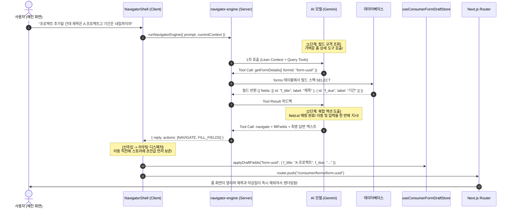

> [!WARNING]
> **ARCHIVED SPECIFICATION (READ-ONLY)**
> 본 문서는 구현 완료 후 동결된 과거 기록입니다.
> 현재 시스템의 구현 규격은 `/src` 실제 코드를 참조하세요. AI 에이전트는 이 문서를 최신 코드로 인용하지 마십시오.

# [Spec-003] On-Demand Data Fetching & Multi-Step AI Navigator Engine (Unified Immutable ID Architecture)

> [!NOTE]
>
> - **상태 (Status)**: Archived (구현 완료 및 동결)
> - **브랜치 (Branch)**: `feat/spec-003-on-demand-navigator-engine`
> - **작성일 (Created)**: 2026-11-09
> - **완료일 (Archived)**: 2026-11-10

---

## 1. 배경 및 문제 정의 (Context & Problem Statement)

기존 네비게이터 엔진(`Spec-001`, `Spec-002`)은 사용자가 발화를 입력할 때마다 서버가 빌더와 컨슈머 모드 구분 없이 등록된 모든 폼 목록(`findActiveForms`, `findPublishedForms`)과 무거운 필드 스키마 전체를 일괄 조회하여 프롬프트 텍스트에 강제로 밀어 넣는 **사전 전량 주입(Eager Pre-injection)** 방식을 사용하고 있었습니다.

또한 폼 레벨의 `slug`와 필드 레벨의 `name`이라는 가변 식별자가 불변 고유키 `id (UUID)`와 혼재되어 다음과 같은 구조적 결함을 유발했습니다:

1. **무거운 스키마 전량 주입으로 인한 토큰 낭비 및 환각**:
   - 폼과 필드가 늘어날수록 수만 토큰이 소모되며, 현재 사용자의 의도와 무관한 수많은 스키마가 모델의 주의력을 분산시켜 판단 오류를 유발합니다.
2. **화면 렌더링 데이터(React Query Cache)와의 단절**:
   - 사용자가 빌더 폼 목록(`/builder/forms`)이나 컨슈머 응답 목록(`/submissions`)을 보면서 _"두 번째 거 열어줘"_ 또는 _"홍길동 거 수정할래"_라고 말했을 때, 화면에 이미 렌더링된 캐시 데이터를 에이전트가 알지 못해 불필요한 DB 재조회가 발생하거나 정확한 대상을 매칭하지 못합니다.
3. **가변 슬러그/필드명(Name)으로 인한 참조 깨짐(Broken Reference) 및 AI 혼선**:
   - 폼 식별에 `slug`를 쓰고 필드 바인딩에 `name`을 쓰면, 사용자나 AI가 폼/필드명을 바꿀 때 기존 응답(JSONB)과의 연결이 끊어지거나 DB 유니크 제약 충돌이 발생합니다.
   - Google Forms / Typeform과 동일하게 **폼 레벨은 불변 UUID(`formId`), 필드 레벨은 불변 ID(`field.id`)로 영속화 키를 단일화**하고, 사용자가 읽는 `title`과 `label`은 순수 표시용 메타데이터로 분리해야 합니다.
4. **단발성 추론의 한계 (원샷 복합 명령 불가)**:
   - `maxSteps: 1` 수준의 단발 호출로는 메인 화면에서 _"프로젝트 추가할 건데 제목은 A고 기간은 내일까지야"_와 같이 **'폼 스펙 조회 -> 대상 화면 이동 -> 필드 값 자동 입력'**으로 이어지는 복합 작업을 한 턴에 연속적으로 해결할 수 없습니다.

따라서 사전 전량 주입을 걷어내고, **"불변 ID 모델 기반으로 화면에 이미 보이는 캐시 데이터는 즉시 활용하며, 화면에 없는 대상은 가벼운 ID/제목 위주로 선별 검색한 뒤 정밀 조회하여 연쇄 조작하는"** 지능형 **Multi-step Agentic Loop** 아키텍처로 전면 개편합니다.

---

## 2. 목표 및 비목표 (Goals & Non-Goals)

### Goals

1. **불변 ID 모델 단일화 (Unified Immutable ID Architecture)**:
   - **폼 레벨**: `forms.slug` 컬럼 및 유니크 인덱스 전면 제거, URL 라우팅 및 조회 키를 불변 기본키 `id (UUID)`로 통합 (`/builder/forms/[id]`, `/consumer/forms/[id]`).
   - **필드 레벨**: `field.name` 전면 제거, 저장 JSON(`submissions.data`) 키 및 폼 바인딩 키를 `field.id`로 단일화. 엑셀/화면 출력 시에만 `field.id` -> `field.label` 매핑.
2. **사전 전량 주입 제거 및 초경량 프롬프트(Lean Context) 전환 (빌더/컨슈머 공통)**:
   - 매 호출마다 전체 폼 목록 텍스트를 생성하던 서버 로직을 전면 제거하고, 현재 화면 경로 및 현재 열린 폼의 기본 메타데이터만 전달.
3. **화면 렌더링 데이터(React Query Cache) 시야 제공 (In-View Fast Path)**:
   - 빌더 폼 목록 화면: 화면에 렌더링된 캐시 목록(`visibleForms`)을 에이전트에 공급 (_"두 번째 폼 삭제해줘"_ 등 즉시 처리).
   - 컨슈머 응답 목록 화면: 화면 테이블에 렌더링된 캐시 목록(`visibleSubmissions`)을 공급 (_"두 번째 응답 열어줘"_ 등 즉시 처리).
4. **가벼운 식별 정보 중심의 단계적 폼 조회 도구(Query Tools) 2종 신설**:
   - `searchForms({ keyword, mode })`: 무거운 스키마 없이 `id, title, description` 중심의 가벼운 메타데이터 선별 검색.
   - `getFormDetails({ formId })`: 원샷 명령 시 필드 ID를 매핑하기 위한 대상 폼 1개의 필드 스펙 정밀 조회.
5. **다단계 오케스트레이션 루프(`stepCountIs: 5`) 구현**:
   - Vercel AI SDK `generateText`의 `stopWhen: stepCountIs(5)`를 활성화하여 `도구로 팩트 확인 -> 후속 판단 -> 기존 액션(이동/입력/수정) 실행`을 단일 요청 내에서 자율 완주.
6. **원샷 복합 명령을 위한 복합 액션 배열(`actions: NavigatorAction[]`) 및 스토어 선주입 보존**:
   - 에이전트가 단일 액션뿐만 아니라 연속적인 액션 파이프라인(`[NAVIGATE, FILL_FIELDS]`)을 한 번에 반환할 수 있도록 확장.
   - 화면 이동 직전 `useConsumerFormDraftStore`에 초안값을 먼저 안전하게 적재(선주입)하고 `router.push`하여, 이동된 폼 화면이 열리자마자 인풋 필드에 값이 즉시 채워지도록 보장.
7. **시스템 관리 필드 원천 격리 및 전용 발행 API (중앙 시계 권한 아키텍처)**:
   - **폼 메타데이터 스키마**: 시스템/시간 메타데이터 5종(`id`, `createdAt`, `updatedAt`, `deletedAt`, `publishedAt`)에 대한 클라이언트 직접 주입/변조 원천 차단 (`insertFormSchema`, `updateFormSchema` 스키마 레벨 `.omit`).
   - **폼 응답 스키마**: 시스템/시간 메타데이터 4종(`id`, `createdAt`, `updatedAt`, `deletedAt`) 및 수정 시 부모 폼 식별자(`formId`)에 대한 클라이언트 직접 주입/변조 원천 차단 (`insertFormSubmissionSchema`, `updateFormSubmissionSchema` 스키마 레벨 `.omit`).
   - 전용 발행 엔드포인트(`POST /api/v1/forms/[id]/publish`) 신설 및 PostgreSQL 중앙 시계(`sql`now()``) 기반의 단일 시간 소스 보장 (클라이언트 로컬 시계 의존성 완전 제거).
   - 활성 필드가 0개인 빈 폼 발행 방지 가드레일 적용.
   - AI Navigator `PUBLISH_FORM` 액션 핸들러 및 빌더 캔버스/목록 UI 마우스 토글 버튼 연동.

### Non-Goals

- **슬러그 복원 배제**: 향후 SEO가 필요한 외부 마케팅 랜딩 페이지가 요구되지 않는 한 내부 엔터프라이즈 업무 시스템에 슬러그를 재도입하지 않음.
- **불필요한 응답 본문 도구 조회 배제**: 과거 응답 데이터는 수정 화면 컴포넌트(`ConsumerSubmissionEditor`)가 자체 마운트하므로, 에이전트가 응답 본문을 직접 읽어오는 중복 도구는 작성하지 않음 (YAGNI 준수).
- **자유 형식 Text-to-SQL 도입 금지**: 에이전트에게 임의의 SQL 생성 권한을 부여하지 않고, 오직 사전 정의된 안전한 API 도구만 호출하도록 제한.

---

## 3. 제안 솔루션 및 계약 (Proposed Solution & Contracts)

### 1) FSD 아키텍처 계층 배치

```text
src/
├── shared/
│   └── tables/
│       └── forms.table.ts             # [단순화] slug 컬럼 및 복합 유니크 인덱스 제거
├── entities/
│   ├── form/
│   │   ├── schema/
│   │   │   ├── form-field.schema.ts   # [단순화] coreFormFieldSchema에서 name 제거, activeFormSchema에서 slug 제거
│   │   │   ├── dynamic-form.schema.ts # [통합] field.id 기반 런타임 동적 Zod 스키마 생성 및 검증
│   │   │   └── form.schema.ts         # [단순화] insertFormSchema에서 slug 제거
│   │   └── server/
│   │       └── form.server.ts         # [단순화] findFormById, softDeleteFormsByIds 기반 일원화
│   └── form-submission/
│       └── store/
│           ├── consumer-form-draft.store.ts   # [단순화] currentFormId 기반 초안 선주입 및 보존
│           └── consumer-form-draft.store.test.ts
├── features/
│   └── execute-navigator-action/
│       ├── lib/
│       │   ├── tools/
│       │   │   ├── query-tools.ts             # [신설] searchForms, getFormDetails (formId 기반)
│       │   │   ├── builder-tools.ts           # [단순화] formId 기반 스키마 조작 및 삭제
│       │   │   └── consumer-tools.ts          # [단순화] formId 및 field.id 기반 입력/제출/삭제
│       │   └── prompts/
│       │       ├── builder-prompt.ts          # [경량화] activeForms 전량 주입 제거, visibleForms 반영
│       │       └── consumer-prompt.ts         # [경량화] publishedForms 전량 주입 제거, visibleSubmissions 반영
│       ├── server/
│       │   ├── navigator-engine.server.ts     # [강화] stepCountIs(5) 다단계 오케스트레이션 및 actions[] 수집
│       │   └── navigator-engine.server.test.ts # [검증] 다단계 연쇄 도구 및 원샷 복합 명령 시나리오 검증
│       └── types/
│           └── navigator-action.types.ts      # [확장] actions: NavigatorAction[], formId, field.id 기반
└── widgets/
    └── navigator-shell/
        └── ui/
            ├── navigator-shell.tsx            # [보강] React Query 캐시 바인딩 및 복합 액션 순차 디스패치
            └── navigator-shell.test.tsx
```

---

## 4. 데이터 계약 및 인터페이스

### 1) `NavigatorClientContext` 규격 (`navigator-action.types.ts`)

```typescript
export interface VisibleItemSummary {
  id: string; // 폼 또는 응답 고유 UUID
  title: string;
  createdAt?: string;
  summary?: string;
}

export interface NavigatorClientContext {
  currentPath?: string;
  // Builder Context
  currentForm?: {
    id: string;
    title: string;
    description?: string;
    fields: CoreFormField[];
  };
  visibleForms?: VisibleItemSummary[]; // 빌더 폼 목록 테이블의 렌더링 캐시

  // Consumer Context
  currentFormId?: string;
  currentFormTitle?: string;
  availableFields?: Array<{
    id: string;
    label: string;
    type: string;
    required?: boolean;
    options?: string[];
  }>;
  currentDraftValues?: Record<string, unknown>; // [field.id]: value
  visibleSubmissions?: VisibleItemSummary[]; // 컨슈머 응답 목록 테이블의 렌더링 캐시
}

export interface NavigatorExecutionResponse {
  reply: string;
  message: string;
  action?: NavigatorAction | null;
  actions?: NavigatorAction[]; // [신규] 연속 실행할 복합 액션 배열 (예: [NAVIGATE, FILL_FIELDS])
}
```

### 2) 신규 조회 도구(Query Tools) 인터페이스 계약 (`query-tools.ts`)

```typescript
// 1. 가벼운 식별 메타데이터 중심의 폼 선별 검색 도구
export const searchFormsTool = tool({
  description:
    "등록된 폼 목록을 키워드로 검색하여 폼 제목, ID(UUID), 기본 설명 등의 가벼운 식별 메타데이터를 반환합니다.",
  parameters: z.object({
    keyword: z.string().optional().describe("검색할 폼 제목이나 설명 키워드"),
  }),
  execute: async ({ keyword }) => {
    // 무거운 필드 스키마 없이 [{ id, title, description }] 배열 반환
  },
});

// 2. 타깃 폼 1개의 상세 필드 스펙 정밀 조회 도구
export const getFormDetailsTool = tool({
  description:
    "특정 폼의 전체 필드 스펙(field.id, label, type, required, options)을 정밀 조회합니다. 필드 값을 매핑하거나 스키마를 확인할 때 호출합니다.",
  parameters: z.object({
    formId: z.string().uuid("조회할 폼 ID(UUID)는 필수입니다."),
  }),
  execute: async ({ formId }) => {
    // 대상 폼 1개의 필드 스키마 배열 반환
  },
});
```

---

## 5. 원샷 복합 명령 다단계 오케스트레이션 시퀀스



---

## 6. 검증 파이프라인 완주 내역

- **TypeScript Typecheck (`tsc --noEmit`)**: 결함 0건
- **ESLint (`eslint`)**: 결함 0건, 경고 0건
- **Prettier (`prettier --check .`)**: 서식 100% 준수
- **Vitest Unit & Component Tests**: 35개 테스트 파일 전체 통과 (총 187개 테스트 100% 성공)
